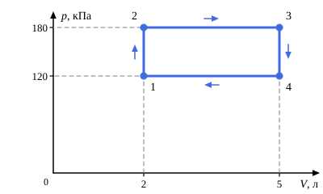

Одноатомный идеальный газ совершает цикл, показанный на графике: 1→2 — изохорное увеличение давления от $120$ до $180\ \text{кПа}$ при объёме $2\ \text{л}$; 2→3 — изобарное расширение до $5\ \text{л}$; 3→4 — изохорное уменьшение давления до $120\ \text{кПа}$; 4→1 — изобарное сжатие. Найди КПД цикла. Ответ дай в процентах, округлив до десятых.

## Решение

Работа за цикл — площадь прямоугольника: ${A = (180 - 120) \cdot (5 - 2) = 180\ \text{Дж}}$.

Теплоту газ получает на 1→2 и 2→3:

$$
Q_{12} = \frac{3}{2} \cdot 2 \cdot 60 = 180\ \text{Дж},
\qquad
Q_{23} = \frac{5}{2} \cdot 180 \cdot 3 = 1350\ \text{Дж}.
$$

${Q_1 = 1530\ \text{Дж}}$.

$$
\eta = \frac{A}{Q_1} = \frac{180}{1530} \approx 0{,}118 = 11{,}8\,\%.
$$

Ответ: $11{,}8\,\%$.
