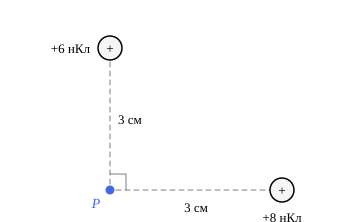

Точечные заряды $+6\ \text{нКл}$ и $+8\ \text{нКл}$ закреплены на сторонах прямого угла на расстоянии $3\ \text{см}$ от его вершины $P$ (см. рисунок). Найди напряжённость электрического поля в точке $P$. ${k = 9 \cdot 10^9\ \text{Н} \cdot \text{м}^2/\text{Кл}^2}$. Ответ дай в киловольтах на метр.

## Решение

Поле каждого заряда в точке $P$:

$$
E_1 = 9 \cdot 10^9 \cdot \frac{6 \cdot 10^{-9}}{0{,}03^2} = 6 \cdot 10^4\ \text{В/м} = 60\ \text{кВ/м},
$$

$$
E_2 = 9 \cdot 10^9 \cdot \frac{8 \cdot 10^{-9}}{0{,}03^2} = 8 \cdot 10^4\ \text{В/м} = 80\ \text{кВ/м}.
$$

Заряды положительные, поле каждого направлено от него вдоль своей стороны угла — векторы перпендикулярны. По теореме Пифагора:

$$
E = \sqrt{60^2 + 80^2} = 100\ \text{кВ/м}.
$$

Ответ: $100\ \text{кВ/м}$.
