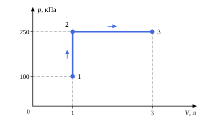

Одноатомный идеальный газ переводят из состояния 1 в состояние 3 так, как показано на графике. Какое количество теплоты получил газ на участке 1–2–3?

## Решение

Участок 1–2: объём постоянен, работы нет,

$$
Q_{12} = \frac{3}{2}V\,(p_2 - p_1) = 1{,}5 \cdot 1 \cdot 150 = 225\ \text{Дж}.
$$

Участок 2–3: давление постоянно,

$$
Q_{23} = \frac{5}{2}\,p\,(V_3 - V_2) = 2{,}5 \cdot 250 \cdot 2 = 1250\ \text{Дж}.
$$

Всего ${Q = 225 + 1250 = 1475\ \text{Дж}}$.

Ответ: $1475\ \text{Дж}$.
