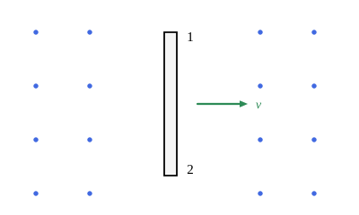

Металлический стержень движется вправо в однородном магнитном поле, направленном к нам (точки). Какой конец стержня — 1 или 2 — зарядится положительно? В ответ запиши номер конца.

## Решение

Свободные электроны движутся вместе со стержнем вправо. Для положительного заряда: поле к нам входит в ладонь левой руки — ладонь смотрит от нас, четыре пальца — вправо. Большой палец показывает вниз. На электроны сила направлена вверх: они собираются у конца 1, а у конца 2 их не хватает — он заряжен положительно.

Ответ: $2$.
