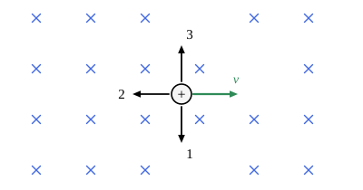

Протон влетает в однородное магнитное поле, направленное от нас (крестики). Его скорость направлена вправо. Какой стрелкой — 1, 2 или 3 — направлена сила Лоренца, действующая на протон? В ответ запиши номер стрелки.

## Решение

Линии поля идут от нас и входят в ладонь левой руки — ладонь смотрит на нас. Четыре пальца — вправо, по скорости протона. Отогнутый большой палец показывает вверх.

Ответ: $3$.
