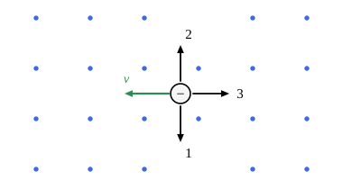

Электрон влетает в однородное магнитное поле, направленное к нам (точки). Его скорость направлена влево. Какой стрелкой — 1, 2 или 3 — направлена сила Лоренца, действующая на электрон? В ответ запиши номер стрелки.

## Решение

Сначала — как для положительной частицы. Линии поля идут к нам и входят в ладонь левой руки — ладонь смотрит от нас. Четыре пальца — влево, по скорости. Большой палец показывает вверх.

Электрон заряжен отрицательно, поэтому сила на него направлена в обратную сторону — вниз.

Ответ: $1$.
