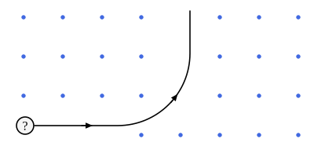

На рисунке — след заряженной частицы в однородном магнитном поле, направленном к нам (точки). Частица влетела слева, двигаясь вправо, и её след загибается вверх. Какой у неё заряд? В ответ запиши $1$, если заряд положительный, и $2$, если отрицательный.

## Решение

След загибается вверх, значит, сила, которая поворачивает частицу, направлена вверх.

Для положительной частицы: линии поля идут к нам и входят в ладонь левой руки — ладонь смотрит от нас, четыре пальца — вправо, по скорости. Большой палец показывает вниз. А сила направлена вверх — в обратную сторону. Значит, заряд отрицательный.

Ответ: $2$.
