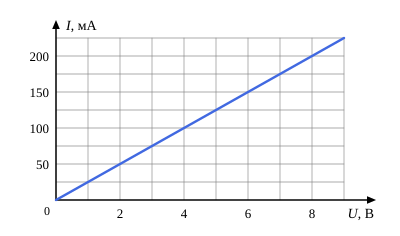

На рисунке — график зависимости силы тока в резисторе от напряжения на нём. Найди сопротивление резистора. Ответ дай в омах.

## Решение

Прямая проходит через узел сетки: ${U = 8\ \text{В}}$, ${I = 200\ \text{мА} = 0{,}2\ \text{А}.}$ По закону Ома

$$
R = \frac{U}{I} = \frac{8}{0{,}2} = 40\ \text{Ом}.
$$

Ответ: $40\ \text{Ом}$.
