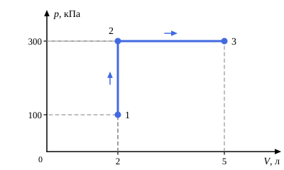

Газ переводят из состояния 1 в состояние 3 так, как показано на графике. Какую работу совершает газ в процессе 1 → 2 → 3?

## Решение

На участке 1 → 2 объём не меняется: работы нет. На участке 2 → 3 давление постоянно:

$$
A = p\,(V_3 - V_2) = 3 \cdot 10^5 \cdot (5 - 2) \cdot 10^{-3} = 900\ \text{Дж}.
$$

Работа за весь процесс — площадь под графиком, то есть под отрезком 2 → 3.

Ответ: $900\ \text{Дж}$.
