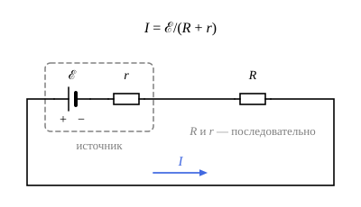

Почему фонарик светит тусклее, если батарейка садится? Почему при коротком замыкании провода плавятся? Ответ даёт закон Ома для полной цепи. Он нужен в задачах 11, 14, 15, 23 и 25.

В 8 классе источник тока считали идеальным. В 10 классе учитывают, что у него есть своё сопротивление, — и появляется закон Ома для полной цепи. Пригодится тема «Закон Ома для участка цепи».

## Шаг 1. Источник тока и ЭДС (10 класс)

Чтобы по цепи шёл ток, нужен **источник**: батарейка, аккумулятор, генератор. Внутри источника **сторонние силы** (химические, механические) разделяют заряды и «поднимают» их, как насос поднимает воду.

**Электродвижущая сила** (ЭДС) — работа сторонних сил по перемещению единичного положительного заряда внутри источника:

$$
\mathcal{E} = \frac{A_{\text{ст}}}{q}.
$$

Единица — вольт. На батарейке написано «$1{,}5\ \text{В}$» — это её ЭДС.

<pp-task id="ks-emf-01"></pp-task>

## Шаг 2. Закон Ома для полной цепи (10 класс)

У любого источника есть **внутреннее сопротивление** $r$: ток проходит и через сам источник. Источник с ЭДС $\mathcal E$ и внутренним сопротивлением $r$ замкнут на внешнее сопротивление $R$:

$$
I = \frac{\mathcal{E}}{R + r}.
$$

- $\mathcal E$ — ЭДС, В;
- $R$ — сопротивление внешней цепи, Ом;
- $r$ — внутреннее сопротивление источника, Ом.

Это похоже на последовательное соединение: внешнее и внутреннее сопротивления складываются.

<pp-task id="ks-emf-02"></pp-task>

## Шаг 3. Напряжение на зажимах (10 класс)

ЭДС «тратится» на две части цепи: $\mathcal{E} = IR + Ir$. Здесь $IR = U$ — напряжение на внешней цепи (его показывает вольтметр на зажимах источника), а $Ir$ — падение напряжения внутри источника. Значит,

$$
U = \mathcal{E} - Ir.
$$

Чем больше ток, тем меньше напряжение на зажимах. Включили мощный прибор — свет на секунду моргнул: ток вырос, напряжение просело.

Если цепь разомкнута ($I = 0$), идеальный вольтметр на зажимах показывает $U = \mathcal E$.

<pp-task id="ks-emf-03"></pp-task>

## Шаг 4. Короткое замыкание (10 класс)

Если внешнее сопротивление почти нулевое ($R \to 0$), ток максимален:

$$
I_{\text{кз}} = \frac{\mathcal{E}}{r}.
$$

Он может быть огромным: провода нагреваются, изоляция плавится. Поэтому в цепи ставят предохранители.

<pp-task id="ks-emf-04"></pp-task>

## Шаг 5. Как найти ЭДС и внутреннее сопротивление (10 класс)

$\mathcal E$ и $r$ не видны снаружи, но их можно найти по двум опытам с разными внешними сопротивлениями. Для каждого опыта запиши закон Ома для полной цепи:

$$
\mathcal{E} = I_1 (R_1 + r), \qquad \mathcal{E} = I_2 (R_2 + r).
$$

Два уравнения, две неизвестные. Приравняй правые части — найдёшь $r$, потом $\mathcal E$.

<pp-task id="ks-emf-05"></pp-task>

## Шаг 6. Как меняются величины (10 класс)

Самая частая основа задачи 15: «сопротивление реостата увеличили».

- $R$ выросло → ток $I = \mathcal E/(R + r)$ **уменьшился**;
- напряжение на зажимах $U = \mathcal E - Ir$ **увеличилось**;
- ЭДС **не изменилась** — это свойство источника.

## Шаг 7. Энергетический смысл (10 класс)

Умножим $\mathcal{E} = IR + Ir$ на ток $I$:

$$
\mathcal{E} I = I^2 R + I^2 r.
$$

Слева — мощность сторонних сил источника. Справа — мощность, которая выделяется во внешней цепи, и мощность, которая греет сам источник. Поэтому аккумулятор телефона нагревается при быстрой зарядке и при большой нагрузке: чем больше ток, тем больше потери $I^2 r$ внутри. Подробнее о мощности — в теме «Работа и мощность тока».

<pp-task id="ks-emf-06"></pp-task>

## Частые ловушки

- **Забывают внутреннее сопротивление.** $I = \mathcal E/R$ верно только если $r = 0$.
- **Считают, что вольтметр на зажимах всегда показывает ЭДС.** Только при разомкнутой цепи.
- **Думают, что ЭДС меняется при изменении нагрузки.** ЭДС — характеристика источника.
- **Путают $U$ на внешней цепи с $Ir$.**

## Как это выглядит на ЕГЭ

*Источник с ЭДС $12\ \text{В}$ и внутренним сопротивлением $1\ \text{Ом}$ замкнут на резистор $5\ \text{Ом}$. Что показывает вольтметр, подключённый к резистору?*

Ток в цепи:

$$
I = \frac{\mathcal{E}}{R + r} = \frac{12}{5 + 1} = 2\ \text{А}.
$$

Напряжение на резисторе: $U = IR = 2 \cdot 5 = 10\ \text{В}$.

Оставшиеся $2\ \text{В}$ «теряются» внутри источника: $Ir = 2 \cdot 1 = 2\ \text{В}$.

## Коротко

- ЭДС — работа сторонних сил на единичный заряд, $\mathcal E = A_{\text{ст}}/q$.
- $I = \mathcal E/(R + r)$.
- $U = IR = \mathcal E - Ir$.
- $I_{\text{кз}} = \mathcal E/r$.
- Два опыта с разными $R$ дают $\mathcal E$ и $r$.
- Нагрузку увеличили ($R \uparrow$): $I \downarrow$, $U \uparrow$, $\mathcal E$ — та же.
