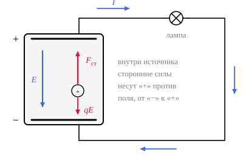

Урок 5.7 закончился вопросом: что происходит внутри самого источника? Во всей теме «Ток, сопротивление и закон Ома для участка цепи» источник был просто «$U$ на полюсах», которое не меняется. Пора заглянуть внутрь.

## Что делает источник

Во внешней цепи — в проводах, лампе, резисторе — положительные заряды идут от «+» источника к «−»: их гонит поле, и оно совершает над ними работу (урок 5.2). Но ток идёт по **замкнутой** цепи (урок 5.1). Дойдя до «−», заряд должен пройти через сам источник и вернуться к «+».

А внутри источника поле его полюсов направлено так же, от «+» к «−», — как между пластинами конденсатора (урок 4.2). Оно толкает положительный заряд **назад**, к «−». Поле не может само поднять заряд обратно. Это делают силы другой природы — **сторонние силы**:

- в батарейке и аккумуляторе — химические реакции;
- в генераторе электростанции — магнитное поле (о нём — в теме «Электромагнитная индукция»);
- в солнечной батарее — свет.

Так работает насос в фонтане. Вода сама стекает сверху вниз, а насос поднимает её обратно, и она течёт снова и снова. Источник — такой «насос» для зарядов: внутри он поднимает их против поля, снаружи они сами «стекают» по цепи.

## Электродвижущая сила

Насос характеризуют тем, на какую высоту он поднимает воду. Источник — тем, какую работу его сторонние силы совершают над каждым кулоном заряда. Эту величину называют **электродвижущей силой**, или **ЭДС**, и обозначают $\mathcal{E}$:

$$
\mathcal{E} = \frac{A_{\text{ст}}}{q}.
$$

- $A_{\text{ст}}$ — работа сторонних сил внутри источника, Дж;
- $q$ — заряд, прошедший через источник, Кл.

Единица ЭДС, как и напряжения, — **вольт**: ${1\ \text{В} = 1\ \text{Дж/Кл}}$ (урок 5.2). Несмотря на название, ЭДС — не сила в смысле механики, а работа на кулон. На батарейке пишут именно ЭДС: «$1{,}5\ \text{В}$» значит, что над каждым кулоном, прошедшим через неё, сторонние силы совершают работу ${1{,}5\ \text{Дж}.}$

**Пример.** Через батарейку с ЭДС ${1{,}5\ \text{В}}$ прошёл заряд ${100\ \text{Кл}.}$ Сторонние силы совершили работу

$$
A_{\text{ст}} = \mathcal{E} q = 1{,}5 \cdot 100 = 150\ \text{Дж}.
$$

<pp-task id="ks-emf-01"></pp-task>

<pp-task id="ks-emf-07"></pp-task>

## ЭДС — свойство источника

ЭДС зависит от того, что внутри источника: от веществ, которые реагируют в батарейке, от устройства генератора. Маленькая батарейка «мизинчиковая» и большая «пальчиковая» дают одну и ту же ЭДС ${1{,}5\ \text{В}}$ — химия у них одна. И от того, что к источнику подключили — лампу, резистор или ничего, — ЭДС не зависит.

Сравни ЭДС с напряжением. Обе величины — работа на кулон и измеряются в вольтах. Но напряжение на участке цепи — работа **поля** (урок 5.2), а ЭДС — работа **сторонних сил** внутри источника.

## Идеальный источник и настоящий

В темах раньше мы считали, что источник держит на полюсах одно и то же напряжение, какую бы нагрузку к нему ни подключили. Такой источник называют **идеальным**. У настоящего источника напряжение на полюсах зависит от тока: чем больше ток, тем оно меньше. Почему — в следующих уроках.

Проверь себя: может ли во внешней цепи, без источника, положительный заряд сам пойти от «−» к «+»?

Нет. Во внешней цепи заряды движет только поле, а оно направлено от «+» к «−». Чтобы вернуть заряд от «−» к «+», нужна работа сторонних сил, а они есть только внутри источника.

## Частые ловушки

- **Считают ЭДС силой.** ЭДС — работа сторонних сил на кулон, в вольтах, а не в ньютонах.
- **Думают, что ЭДС зависит от того, что подключено.** ЭДС — свойство самого источника.
- **Путают ЭДС и напряжение.** ЭДС — работа сторонних сил внутри источника, напряжение — работа поля на участке цепи.

## Коротко

- Внутри источника сторонние силы несут заряды против поля, от «−» к «+».
- ${\mathcal{E} = A_{\text{ст}}/q}$ — работа сторонних сил на кулон, в вольтах.
- ЭДС не зависит от нагрузки; на батарейке написана её ЭДС.

Дальше — урок 6.2: как найти ток в цепи с настоящим источником.
