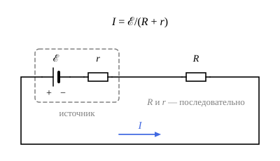

Батарейка, лампа и провода — это полная цепь. В уроке 5.3 мы находили ток в лампе по закону Ома для участка: ${I = U/R}$. Но в полной цепи есть ещё один участок, через который идёт тот же ток, — сам источник.

## Внутреннее сопротивление

Внутри батарейки заряды проходят через её вещества: раствор, пасту, металлические части. Они мешают току так же, как любой проводник (урок 5.4). Это сопротивление источника называют **внутренним** и обозначают $r$. Сопротивление всего, что подключено к источнику снаружи, — **внешнее**, $R$.

На схеме настоящий источник рисуют как идеальный источник с ЭДС $\mathcal{E}$ и резистор $r$ рядом с ним. Они спрятаны в одном корпусе, поэтому их обводят пунктиром.

## Закон Ома для полной цепи

Посмотри на схему: ток выходит из «+», проходит через $R$, потом через $r$ и возвращается к «−». Других путей нет, так что $R$ и $r$ соединены **последовательно** (урок 5.5). Общее сопротивление цепи — ${R + r}$, а «напряжение», которое гонит ток по всей цепи, — ЭДС. Отсюда **закон Ома для полной цепи**:

$$
I = \frac{\mathcal{E}}{R + r}.
$$

- $I$ — сила тока в цепи, А;
- $\mathcal E$ — ЭДС источника, В;
- $R$ — сопротивление внешней цепи, Ом;
- $r$ — внутреннее сопротивление источника, Ом.

Если внешняя цепь сложная, сначала сверни её в одно сопротивление $R$, как в уроке 5.7.

**Пример.** Батарейка с ЭДС ${1{,}5\ \text{В}}$ и внутренним сопротивлением ${0{,}25\ \text{Ом}}$ замкнута на резистор ${3{,}5\ \text{Ом}.}$ Ток

$$
I = \frac{\mathcal{E}}{R + r} = \frac{1{,}5}{3{,}5 + 0{,}25} = \frac{1{,}5}{3{,}75} = 0{,}4\ \text{А}.
$$

Если забыть про $r$, получится ${1{,}5/3{,}5 \approx 0{,}43\ \text{А}}$ — ошибка в ответе ЕГЭ.

<pp-task id="ks-emf-02"></pp-task>

<pp-task id="ks-emf-08"></pp-task>

## Когда источник можно считать идеальным

Если внутреннее сопротивление намного меньше внешнего, ${R + r \approx R}$, и ${I \approx \mathcal{E}/R}$ — это закон Ома для участка, где напряжение равно ЭДС. Так мы и считали в уроках 5.5–5.7: источник был идеальным, с ${r = 0}$. Если в задаче сказано, что сопротивлением источника можно пренебречь, так и делай. Если $r$ дано — учитывай его.

Проверь себя: внешнее сопротивление увеличили вдвое. Ток уменьшится вдвое?

Меньше чем вдвое. Ток делят на ${R + r}$, а эта сумма выросла меньше чем вдвое: $r$ осталось прежним. Вдвое — только если ${r = 0}$.

## Частые ловушки

- **Забывают внутреннее сопротивление.** ${I = \mathcal{E}/R}$ верно, только если ${r = 0}$.
- **Подставляют в ${I = \mathcal{E}/(R + r)}$ сопротивление одного резистора, когда во внешней цепи их несколько.** $R$ — сопротивление всей внешней цепи.

## Коротко

- У источника есть внутреннее сопротивление $r$; внешнее $R$ и внутреннее $r$ — последовательно.
- ${I = \mathcal{E}/(R + r)}$.
- При ${r \ll R}$ источник почти идеальный: ${I \approx \mathcal{E}/R}$.

Дальше — урок 6.3: что показывает вольтметр на полюсах источника.
