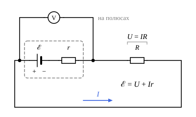

Подключи вольтметр к полюсам батарейки — он покажет почти ровно ${1{,}5\ \text{В}.}$ Подключи к ней ещё и лампу — показание станет меньше. Батарейка та же, ЭДС та же. Куда делась часть вольт?

## ЭДС делится на две части

Закон Ома для полной цепи (урок 6.2) можно переписать так:

$$
\mathcal{E} = IR + Ir.
$$

По закону Ома для участка (урок 5.3) ${IR}$ — напряжение на внешней цепи. Внешняя цепь присоединена к полюсам источника, поэтому это же **напряжение на полюсах** $U$ — его показывает вольтметр, подключённый к полюсам. А ${Ir}$ — напряжение на внутреннем сопротивлении, его называют **падением напряжения** внутри источника. Значит,

$$
U = IR = \mathcal{E} - Ir.
$$

Чем больше ток, тем больше ${Ir}$ и тем меньше напряжение на полюсах. Поэтому, когда в квартире включают мощный прибор, свет на мгновение тускнеет: ток вырос, напряжение просело.

**Пример.** Для батарейки из урока 6.2 (${\mathcal{E} = 1{,}5\ \text{В}}$, ${r = 0{,}25\ \text{Ом}}$, ${R = 3{,}5\ \text{Ом}}$, ${I = 0{,}4\ \text{А}}$) напряжение на полюсах ${U = IR = 0{,}4 \cdot 3{,}5 = 1{,}4\ \text{В}}$, а падение внутри ${Ir = 0{,}4 \cdot 0{,}25 = 0{,}1\ \text{В}.}$ Вместе — ${1{,}5\ \text{В}}$, как и должно быть.

<pp-task id="ks-emf-03"></pp-task>

## Разомкнутая цепь

Если цепь разомкнута, тока нет: ${I = 0}$, и ${U = \mathcal{E}}$. Идеальный вольтметр почти не берёт ток (урок 5.2), поэтому вольтметр, подключённый к полюсам источника без нагрузки, показывает его ЭДС. Так ЭДС и измеряют. А как только пошёл ток, вольтметр показывает уже меньше ЭДС — на ${Ir}$.

<pp-task id="ks-emf-09"></pp-task>

## Почему фонарик тускнеет

Когда батарейка садится, её ЭДС падает не сильно, а вот внутреннее сопротивление растёт. Ток уменьшается, падение ${Ir}$ внутри растёт, и на лампу остаётся всё меньше напряжения. Пусть у батарейки из примера $r$ выросло до ${3{,}5\ \text{Ом}}$ — стало таким же, как у лампы. Тогда ЭДС делится между ними поровну, и на лампе только половина: ${0{,}75\ \text{В}}$ вместо ${1{,}4\ \text{В}.}$ А вольтметр на полюсах такой батарейки без нагрузки по-прежнему покажет почти ${1{,}5\ \text{В}}$ — поэтому проверять батарейку лучше под нагрузкой.

<pp-task id="ks-emf-10"></pp-task>

Проверь себя: почему у идеального источника из уроков 5.5–5.7 напряжение на полюсах не зависело от нагрузки?

У идеального источника ${r = 0}$, поэтому падение ${Ir = 0}$ при любом токе, и ${U = \mathcal{E}}$ всегда.

## Частые ловушки

- **Путают показание вольтметра на полюсах с ЭДС.** Они равны, только когда ток не идёт.
- **Путают напряжение на полюсах с падением внутри.** $U$ — на внешней цепи, ${Ir}$ — внутри источника.
- **Прибавляют ${Ir}$ к ЭДС.** На полюсах напряжение меньше ЭДС, а не больше.

## Коротко

- ${\mathcal{E} = IR + Ir}$; ${U = IR = \mathcal{E} - Ir}$ — напряжение на полюсах.
- Больше ток — меньше напряжение на полюсах.
- Цепь разомкнута: ${U = \mathcal{E}}$.
- Батарейка стареет — $r$ растёт, напряжение на нагрузке падает.

Дальше — урок 6.4: что будет, если замкнуть полюса проводом.
