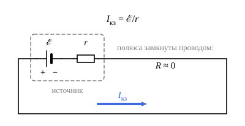

Монетка в кармане рядом с батарейкой, перетёртая изоляция в удлинителе, гвоздь в розетке — во всех этих случаях полюса источника соединяются почти напрямую. Что тогда будет с током?

## Ток короткого замыкания

**Короткое замыкание** — когда полюса источника соединены проводником с очень маленьким сопротивлением. Внешнее сопротивление почти нулевое, ${R \approx 0}$, и закон Ома для полной цепи (урок 6.2) даёт

$$
I_{\text{кз}} = \frac{\mathcal{E}}{r}.
$$

Ток ограничивает только внутреннее сопротивление источника. Больше этого тока источник дать не может: при любом другом $R$ знаменатель ${R + r}$ больше. Напряжение на полюсах при коротком замыкании почти нулевое: ${U = IR \approx 0}$ — вся ЭДС «уходит» на ${Ir}$ внутри.

Внутреннее сопротивление у хороших источников маленькое, поэтому ток короткого замыкания огромный. **Пример.** У новой пальчиковой батарейки ${\mathcal{E} = 1{,}5\ \text{В}}$, а $r$ около ${0{,}1\ \text{Ом}.}$ Ток короткого замыкания

$$
I_{\text{кз}} = \frac{1{,}5}{0{,}1} = 15\ \text{А}
$$

Это примерно в сто раз больше, чем ток лампочки фонарика. У автомобильного аккумулятора $r$ — сотые доли ома, и ток короткого замыкания достигает сотен ампер. Это даже полезно: стартёру, который заводит двигатель, нужен ток в сотни ампер.

<pp-task id="ks-emf-04"></pp-task>

## Чем это опасно

Большой ток сильно греет провода: дрейфующие электроны сталкиваются с ионами металла (урок 5.4), и чем больше ток, тем больше тепла. Изоляция плавится и может загореться. Греется и сам источник — батарейка может потечь, аккумулятор — вспыхнуть.

Поэтому в каждую цепь ставят **предохранитель** — тонкую проволочку, которая перегорает и разрывает цепь, если ток стал больше допустимого. В квартирах то же самое делают **автоматические выключатели** («автоматы»): при слишком большом токе они сами размыкают цепь.

## Ток короткого замыкания и внутреннее сопротивление

Из той же формулы ${r = \mathcal{E}/I_{\text{кз}}}$. Если известны ЭДС и ток короткого замыкания, внутреннее сопротивление найти легко, а дальше — ток при любой нагрузке по закону Ома для полной цепи. Замыкать источник накоротко ради опыта нельзя, но в задачах ток короткого замыкания часто дан или читается по графику (урок 6.5).

<pp-task id="ks-emf-11"></pp-task>

Проверь себя: у двух батареек одинаковая ЭДС, но у первой ток короткого замыкания больше. У какой больше внутреннее сопротивление?

У второй. ${I_{\text{кз}} = \mathcal{E}/r}$: при одинаковой ЭДС ток короткого замыкания тем меньше, чем больше $r$.

## Частые ловушки

- **Думают, что ток короткого замыкания бесконечный.** Его ограничивает внутреннее сопротивление.
- **Путают ток короткого замыкания с рабочим током.** ${I_{\text{кз}} = \mathcal{E}/r}$ — только при ${R \approx 0}$; с нагрузкой ток ${\mathcal{E}/(R + r)}$.

## Коротко

- Короткое замыкание: ${R \approx 0}$, ${I_{\text{кз}} = \mathcal{E}/r}$ — самый большой ток источника.
- Напряжение на полюсах почти нулевое, вся ЭДС теряется внутри.
- Провода и источник греются; защищают предохранители и автоматы.

Дальше — урок 6.5: как найти ЭДС и внутреннее сопротивление, не разбирая источник.
