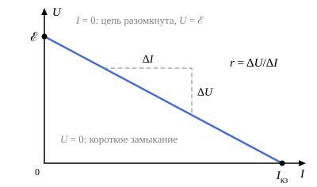

Внутреннее сопротивление не написано на батарейке, а измерить его омметром нельзя: внутри работает ЭДС. Но $\mathcal{E}$ и $r$ можно найти, не разбирая источник, — по тому, как он ведёт себя под разной нагрузкой.

## Два опыта

Подключим к источнику сначала одно сопротивление, потом другое, и оба раза измерим ток. Для каждого опыта запишем закон Ома для полной цепи (урок 6.2):

$$
\mathcal{E} = I_1 (R_1 + r), \qquad \mathcal{E} = I_2 (R_2 + r).
$$

Неизвестных две — $\mathcal{E}$ и $r$, — и уравнений два. ЭДС в обоих опытах одна и та же, поэтому правые части можно приравнять: получится уравнение с одним $r$. Найдя $r$, подставь его в любое из уравнений — получишь $\mathcal{E}$.

**Пример.** С резистором ${6{,}5\ \text{Ом}}$ ток в цепи ${1{,}5\ \text{А}}$, а с резистором ${28{,}5\ \text{Ом}}$ — ${0{,}4\ \text{А}.}$ Приравниваем:

$$
1{,}5\,(6{,}5 + r) = 0{,}4\,(28{,}5 + r),
$$

$$
9{,}75 + 1{,}5r = 11{,}4 + 0{,}4r,
$$

$$
1{,}1r = 1{,}65
\quad\Rightarrow\quad
r = 1{,}5\ \text{Ом}.
$$

Тогда ${\mathcal{E} = 1{,}5 \cdot (6{,}5 + 1{,}5) = 12\ \text{В}.}$ Проверка по второму опыту: ${0{,}4 \cdot (28{,}5 + 1{,}5) = 12\ \text{В}.}$ Сходится.

<pp-task id="ks-emf-05"></pp-task>

## График U(I)

Напряжение на полюсах ${U = \mathcal{E} - Ir}$ (урок 6.3). Это прямая, которая с ростом тока идёт **вниз** — не как у резистора в уроке 5.3, где прямая $I(U)$ шла из начала координат вверх. У прямой источника два особых конца:

- при ${I = 0}$ цепь разомкнута, и ${U = \mathcal{E}}$: прямая начинается на оси $U$ в точке ЭДС;
- при ${U = 0}$ — короткое замыкание (урок 6.4): прямая кончается на оси $I$ в точке ${I_{\text{кз}} = \mathcal{E}/r}$.

Наклон прямой задаёт внутреннее сопротивление: если ток вырос на ${\Delta I}$, напряжение упало на ${\Delta U = r\,\Delta I}$, поэтому ${r = \Delta U/\Delta I}$. Чем больше $r$, тем круче прямая падает. По графику удобно брать точки, которые попадают точно в узлы сетки: ЭДС — на оси $U$, и ещё одну точку прямой. Падение напряжения ${\mathcal{E} - U}$ в этой точке, делённое на ток, и есть $r$.

<pp-task id="ks-emf-12"></pp-task>

## Вольтметр и амперметр

Часто в опыте измеряют не сопротивления, а ток амперметром и напряжение на полюсах вольтметром — при двух положениях движка реостата. Это две точки той же прямой. Для каждой ${U = \mathcal{E} - Ir}$:

$$
U_1 = \mathcal{E} - I_1 r, \qquad U_2 = \mathcal{E} - I_2 r.
$$

Вычтем второе из первого — ЭДС сократится: ${U_1 - U_2 = (I_2 - I_1)\,r}$. Это и есть наклон прямой. Найдя $r$, получим ЭДС из любого уравнения.

<pp-task id="ks-emf-13"></pp-task>

Проверь себя: прямые U(I) двух источников начинаются в одной точке на оси U, но одна падает круче. Что у источников общего и чем они различаются?

ЭДС у них одинаковая: прямые начинаются в одной точке при ${I = 0}$. У источника с более крутой прямой больше внутреннее сопротивление, и его прямая раньше доходит до оси $I$ — ток короткого замыкания у него меньше.

## Частые ловушки

- **Думают, что прямая $U(I)$ источника идёт из начала координат, как у резистора.** Она начинается на ЭДС и идёт вниз.
- **Пишут в двух опытах разные ЭДС.** Источник один — и ЭДС, и $r$ в обоих опытах одни и те же; меняется только нагрузка.

## Коротко

- Два опыта с разной нагрузкой — два уравнения ${\mathcal{E} = I(R + r)}$; приравняй и найди $r$, потом $\mathcal{E}$.
- График ${U = \mathcal{E} - Ir}$ — прямая вниз: на оси $U$ — ЭДС, на оси $I$ — ток короткого замыкания.
- ${r = \Delta U/\Delta I}$ — наклон прямой.

Дальше — урок 6.6: как меняются ток и напряжения, когда меняют нагрузку.
