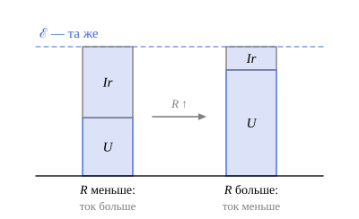

«Движок реостата сдвинули, и его сопротивление увеличилось. Как изменятся сила тока в цепи, напряжение на полюсах источника и ЭДС?» Это самая частая основа задачи 15 ЕГЭ по этой теме. Как и в уроке 4.5, начинать надо с того, что не меняется.

## Что остаётся прежним

ЭДС и внутреннее сопротивление — свойства самого источника (уроки 6.1 и 6.2). Двигай реостат, подключай лампы — $\mathcal{E}$ и $r$ те же. А ток, напряжение на полюсах и падение внутри зависят от нагрузки и меняются вслед за ней.

## План решения

1. ЭДС $\mathcal{E}$ и внутреннее сопротивление $r$ не меняются.
2. Найди, как изменилось полное сопротивление ${R + r}$.
3. Ток ${I = \mathcal{E}/(R + r)}$ меняется наоборот: полное сопротивление выросло — ток уменьшился.
4. Падение внутри ${Ir}$ меняется так же, как ток: $r$ постоянно.
5. Напряжение на полюсах ${U = \mathcal{E} - Ir}$ меняется наоборот по сравнению с ${Ir}$.

**Пример.** Сопротивление реостата увеличили:

- $\mathcal{E}$ и $r$ не меняются;
- полное сопротивление ${R + r}$ выросло;
- ток $I$ уменьшился;
- падение внутри ${Ir}$ уменьшилось;
- напряжение на полюсах ${U = \mathcal{E} - Ir}$ выросло.

Если сопротивление реостата уменьшили — всё наоборот: ток вырос, напряжение на полюсах упало. А в пределе ${R \to 0}$ получится короткое замыкание (урок 6.4).

Удобно помнить картинку: ЭДС — столбик постоянной высоты, который делится на $U$ и ${Ir}$. Что прибавилось к одной части, то убыло у другой. При очень большом $R$ ток почти нулевой, и $U$ почти равно ЭДС — как при разомкнутой цепи.

Заметь: напряжение на полюсах растёт вместе с $R$, но **не во столько же раз**. Ведь ${U = IR}$, а ток при этом уменьшается. Поэтому в задаче «во сколько раз» нужно честно посчитать ток и напряжение до и после.

## Модель: настоящий источник

В модели батарейка с ЭДС и внутренним сопротивлением — внутри пунктирной рамки — замкнута на реостат. Амперметр показывает ток, вольтметр — напряжение на полюсах. Выбери новую или старую батарейку и двигай реостат. В таблице — ЭДС, ток, напряжение на полюсах и падение внутри; ЭДС выделена: она не меняется. Под схемой — прямая ${U(I)}$ источника из урока 6.5, точка на ней показывает ток и напряжение сейчас.

<pp-source>Модель: батарейка с ЭДС и внутренним сопротивлением замкнута на реостат через амперметр, вольтметр подключён к её полюсам. Кнопки выбирают новую или старую батарейку, ползунок меняет сопротивление реостата; таблица показывает ЭДС, ток, напряжение на полюсах и падение напряжения внутри батарейки, график — прямую U(I) источника и точку на ней.</pp-source>

Попробуй:

- уменьшай сопротивление реостата почти до нуля: что стало с напряжением на полюсах и почему ток всё-таки не бесконечный?
- при одном и том же реостате переключи батарейку на старую: что изменилось в таблице и на графике?
- проверь по таблице, что напряжение на полюсах и падение внутри в сумме дают ЭДС.

<pp-task id="ks-emf-14"></pp-task>

Проверь себя: к лампе, подключённой к батарейке, параллельно подключили вторую такую же. Как изменилось напряжение на полюсах батарейки?

Уменьшилось. Параллельно подключённые лампы дают меньшее сопротивление, чем одна (урок 5.6), поэтому внешнее сопротивление уменьшилось. Ток вырос, падение ${Ir}$ внутри выросло, и напряжение на полюсах ${U = \mathcal{E} - Ir}$ упало. Каждая лампа светит чуть тусклее, чем светила одна.

## Частые ловушки

- **Думают, что ЭДС меняется при изменении нагрузки.** ЭДС — свойство источника.
- **Считают напряжение на полюсах постоянным.** Так только у идеального источника; у настоящего оно растёт вместе с $R$.
- **Думают, что напряжение на полюсах растёт пропорционально $R$.** Ток при этом уменьшается, поэтому $U$ растёт медленнее.

## Коротко

- $\mathcal{E}$ и $r$ не меняются.
- $R$ выросло: $I$ ↓, ${Ir}$ ↓, $U$ ↑; $R$ уменьшилось — наоборот.
- ${U + Ir = \mathcal{E}}$: что прибавилось к одной части, то убыло у другой.

Дальше — урок 6.7: куда уходит энергия в полной цепи.
