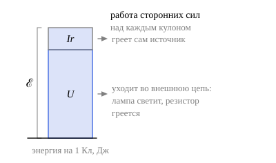

При быстрой зарядке и в тяжёлой игре телефон нагревается — греется и его аккумулятор. Откуда тепло внутри источника, если он сам ничего не «потребляет»? Ответ — в равенстве ${\mathcal{E} = U + Ir}$ из урока 6.3, если прочитать его на языке энергии.

## Энергия каждого кулона

Каждое слагаемое в ${\mathcal{E} = U + Ir}$ — работа на кулон, в джоулях на кулон:

- $\mathcal{E}$ — работа сторонних сил над кулоном внутри источника (урок 6.1);
- $U$ — работа поля над этим кулоном во внешней цепи (урок 5.2): она уходит в свет лампы и тепло резисторов;
- ${Ir}$ — работа поля над ним на внутреннем сопротивлении: она греет сам источник, как ток греет любой проводник (урок 5.4).

Значит, ${\mathcal{E} = U + Ir}$ — это **закон сохранения энергии** для полной цепи: сколько энергии сторонние силы сообщили каждому кулону, столько он и отдал за один обход цепи.

**Пример.** Батарейка с ЭДС ${1{,}5\ \text{В}}$ питает лампу, напряжение на полюсах ${1{,}2\ \text{В}.}$ Над каждым кулоном сторонние силы совершают работу ${1{,}5\ \text{Дж}}$; ${1{,}2\ \text{Дж}}$ получает лампа, а ${0{,}3\ \text{Дж}}$ остаётся в батарейке теплом. Пятая часть энергии тратится зря.

Если через источник прошёл заряд $q$, внутри него выделилось тепло ${q \cdot Ir = q(\mathcal{E} - U)}$.

<pp-task id="ks-emf-15"></pp-task>

## Энергия за секунду

За секунду через цепь проходит $I$ кулонов (урок 5.1). Умножим каждое слагаемое на ток — получим работу за секунду, то есть мощность (урок 11.2 из механики: ${N = A/t}$, в ваттах; в электричестве мощность обозначают $P$):

$$
\mathcal{E} I = UI + I^2 r.
$$

- ${\mathcal{E} I}$ — мощность сторонних сил источника;
- ${UI}$ — мощность, которую получает внешняя цепь;
- ${I \cdot Ir = I^2 r}$ — мощность, которая греет сам источник.

В примере выше при токе ${0{,}5\ \text{А}}$ мощность сторонних сил ${1{,}5 \cdot 0{,}5 = 0{,}75\ \text{Вт}}$, лампа получает ${1{,}2 \cdot 0{,}5 = 0{,}6\ \text{Вт}}$, а на нагрев батарейки уходит ${0{,}3 \cdot 0{,}5 = 0{,}15\ \text{Вт}.}$

Потери внутри растут как **квадрат** тока: ток вдвое больше — тепла внутри вчетверо больше. Поэтому аккумулятор и греется при большой нагрузке. Подробнее о мощности тока — о тепле в резисторе и о том, при какой нагрузке внешняя цепь получает больше всего мощности, — в следующей теме «Работа и мощность тока».

<pp-task id="ks-emf-06"></pp-task>

Проверь себя: почему при коротком замыкании батарейка сильно нагревается?

При коротком замыкании напряжение на полюсах почти нулевое (урок 6.4): ${U \approx 0}$, и ${Ir \approx \mathcal{E}}$. Вся работа сторонних сил над каждым кулоном остаётся внутри источника теплом, а ток при этом самый большой.

## Частые ловушки

- **Считают, что вся работа сторонних сил достаётся внешней цепи.** Часть ${Ir}$ на каждый кулон греет сам источник.
- **Путают мощность источника и мощность во внешней цепи.** Сторонние силы — ${\mathcal{E} I}$, внешняя цепь — ${UI}$, и ${UI}$ меньше.

## Коротко

- ${\mathcal{E} = U + Ir}$ — закон сохранения энергии на каждый кулон.
- Тепло внутри источника при прохождении заряда $q$: ${q(\mathcal{E} - U)}$.
- За секунду: ${\mathcal{E} I = UI + I^2 r}$.

Это последний урок темы. Дальше — тема «Работа и мощность тока»: работа тока, его мощность и тепло в проводниках.
