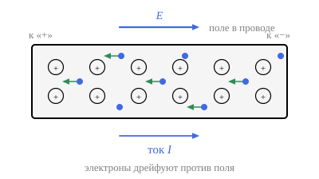
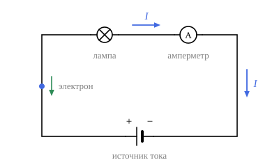

В уроке 3.2 свободные электроны металла сдвигались в поле и почти сразу останавливались: их собственные заряды гасили поле внутри, и двигаться им было уже незачем. А в проводе, по которому лампа соединена с батарейкой, электроны идут и идут — лампа горит часами. Что заставляет их не останавливаться?

## Ток — это движение зарядов

**Электрический ток** — упорядоченное, то есть направленное, движение заряженных частиц. В металле это свободные электроны (урок 3.1). Они и без тока беспорядочно носятся по металлу, но тогда через любое сечение провода их проходит поровну туда и обратно — переноса заряда нет. Ток — это когда к беспорядочному движению добавляется общий медленный сдвиг в одну сторону, **дрейф**.

Двигать электроны в одну сторону может только электрическое поле. В уроке 3.2 поле внутри металла исчезало, потому что заряды скапливались на его краях. Если же концы провода соединить с **источником тока** — батарейкой, аккумулятором, — источник всё время уводит заряды с одного конца и подводит к другому. Заряды скопиться не успевают, поле в проводе остаётся, и электроны дрейфуют непрерывно.

Значит, для тока нужны:

- свободные заряды — то есть проводник;
- источник тока, который держит в проводнике поле;
- **замкнутая цепь**: стоит её разорвать — выключателем или перегоревшей нитью лампы, — и ток прекращается во всей цепи.

## Направление тока

Ток открыли раньше электрона, и за направление тока договорились принимать направление движения **положительных** зарядов. Во внешней цепи ток идёт от «+» источника к «−». Электроны в металле заряжены отрицательно, поэтому движутся **против** тока — от «−» к «+». Эта договорённость осталась, и все правила в физике записаны для неё.

## Сила тока

Ток бывает сильнее и слабее: через сечение провода за секунду проходит больше или меньше заряда. **Сила тока** — заряд, прошедший через поперечное сечение проводника, делённый на время:

$$
I = \frac{q}{t}.
$$

Это как скорость — путь за единицу времени (урок 1.2 из механики), только здесь заряд за единицу времени. Единица силы тока — **ампер** (А): ${1\ \text{А} = 1\ \text{Кл/с}}$. Слабые токи измеряют в миллиамперах: ${1\ \text{мА} = 0{,}001\ \text{А}}$.

Для масштаба: через лампочку фонарика идёт ток в десятые доли ампера, через чайник — около десятка ампер, в молнии — десятки тысяч ампер.

**Пример.** За ${2\ \text{мин}}$ через спираль обогревателя прошёл заряд ${36\ \text{Кл}.}$ Время — в секундах: ${2\ \text{мин} = 120\ \text{с}.}$ Сила тока

$$
I = \frac{q}{t} = \frac{36\ \text{Кл}}{120\ \text{с}} = 0{,}3\ \text{А}.
$$

<pp-task id="ks-ohm-01"></pp-task>

Заряд в кулонах можно пересчитать в электроны: каждый несёт заряд ${e = 1{,}6 \cdot 10^{-19}\ \text{Кл}}$ (урок 1.2). При токе ${1\ \text{А}}$ за секунду через сечение проходит ${1/(1{,}6 \cdot 10^{-19}) \approx 6 \cdot 10^{18}}$ электронов.

<pp-task id="ks-ohm-08"></pp-task>

## Амперметр

Силу тока измеряют **амперметром**. Он должен пропускать через себя тот самый ток, который измеряет, поэтому его включают в цепь **последовательно** — в разрыв провода, друг за другом с прибором, ток в котором нужен. На схеме амперметр — кружок с буквой A.

Сопротивление (о нём — урок 5.3) у амперметра очень маленькое, чтобы он сам почти не мешал току.

## Медленные электроны, быстрый сигнал

Электроны дрейфуют очень медленно: при обычных токах — доли миллиметра в секунду. Почему же лампа загорается сразу, как только щёлкнул выключатель? Потому что сразу по всей цепи появляется **поле**, а оно распространяется почти со скоростью света. Электроны начинают дрейфовать одновременно во всём проводе — в том числе в нити лампы, — и им не нужно бежать от выключателя.

Как в шланге, полном воды: открыл кран — и вода сразу течёт из другого конца, хотя каждая капля прошла лишь чуть-чуть.

Проверь себя: на рисунке цепи амперметр стоит после лампы. Покажет ли он другой ток, если поставить его до лампы?

Нет. Цепь одна, ветвлений нет, и заряд нигде не копится: сколько заряда за секунду входит в лампу, столько и выходит. Поэтому ток во всех местах такой цепи одинаковый, и амперметр покажет одно и то же, где его ни поставь.

## Частые ловушки

- **Считают, что ток идёт по направлению движения электронов.** Направление тока — от «+» к «−» во внешней цепи, электроны движутся навстречу.
- **Подставляют время в минутах.** В ${I = q/t}$ время — в секундах, тогда ток получится в амперах.
- **Думают, что электроны летят по проводу быстро.** Быстро распространяется поле, электроны дрейфуют медленно.

## Коротко

- Ток — упорядоченное движение зарядов; для него нужны свободные заряды, источник и замкнутая цепь.
- Источник держит поле в проводе, поэтому заряды движутся непрерывно.
- Направление тока — от «+» к «−», электроны движутся против тока.
- ${I = q/t}$; ${1\ \text{А} = 1\ \text{Кл/с}}$; амперметр включают последовательно.

Дальше — урок 5.2: что показывает вольтметр.
