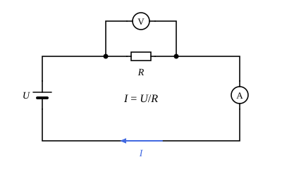
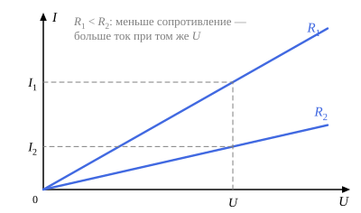

Подключим к резистору сначала одну батарейку, потом две, потом три — друг за другом. Напряжение растёт, и ток тоже. Но как именно: вдвое больше напряжения — вдвое больше тока или как-то иначе? Это измерил Георг Ом в 1826 году.

## Опыт

Соберём цепь: источник, резистор (проводник с известным сопротивлением, на схеме — прямоугольник) и амперметр последовательно, вольтметр — к концам резистора. Меняем напряжение и записываем показания приборов.

Результат простой: во сколько раз увеличили напряжение, во столько же раз вырос ток. Ток **пропорционален** напряжению, а график $I(U)$ — прямая из начала координат.

## Сопротивление

Возьмём другой резистор — прямая пойдёт под другим наклоном. При том же напряжении через один проводник идёт больший ток, через другой — меньший. Свойство проводника препятствовать току называют **сопротивлением** $R$.

Чем больше сопротивление, тем меньше ток при том же напряжении и тем положе прямая. Это и есть **закон Ома для участка цепи**:

$$
I = \frac{U}{R}.
$$

- $I$ — сила тока в проводнике, А;
- $U$ — напряжение на его концах, В;
- $R$ — сопротивление проводника, Ом.

Единица сопротивления — **ом**: ${1\ \text{Ом} = 1\ \text{В/А}}$. Сопротивление ${1\ \text{Ом}}$ у проводника, по которому при напряжении ${1\ \text{В}}$ идёт ток ${1\ \text{А}}$. Большие сопротивления измеряют в килоомах: ${1\ \text{кОм} = 1000\ \text{Ом}}$.

Из закона Ома две другие формы: ${U = IR}$ и ${R = U/I}$. Не нужно заучивать все три — достаточно первой.

**Пример.** К резистору ${150\ \text{Ом}}$ приложили ${4{,}5\ \text{В}.}$ Ток

$$
I = \frac{U}{R} = \frac{4{,}5\ \text{В}}{150\ \text{Ом}} = 0{,}03\ \text{А} = 30\ \text{мА}.
$$

А если при ${9\ \text{В}}$ через проводник идёт ${0{,}3\ \text{А}}$, его сопротивление ${R = U/I = 9/0{,}3 = 30\ \text{Ом}.}$

<pp-task id="ks-ohm-03"></pp-task>

## Сопротивление не зависит от напряжения

Формула ${R = U/I}$ — способ найти сопротивление, а не закон, по которому оно меняется. Удвоим напряжение — ток тоже удвоится, а их отношение останется прежним. Сопротивление зависит от самого проводника: от материала, длины и толщины (урок 5.4).

Так что по графику $I(U)$ сопротивление находят из любой его точки: ${R = U/I}$. Удобнее брать точку, которая попадает точно в узел сетки.

<pp-task id="ks-ohm-10"></pp-task>

## Где закон Ома не работает

Для металлов закон Ома выполняется, пока температура проводника постоянна. А нить лампы накаливания при включении раскаляется, и её сопротивление растёт в несколько раз. Поэтому у лампы ток растёт медленнее напряжения, и график $I(U)$ изгибается вниз — это уже не прямая.

Проверь себя: напряжение на резисторе уменьшили вдвое. Что стало с током и с сопротивлением?

Ток уменьшился вдвое: ${I = U/R}$, а $R$ прежнее. Сопротивление не изменилось — оно зависит от проводника, а не от напряжения.

## Частые ловушки

- **«Сопротивление растёт с напряжением, раз ${R = U/I}$».** Нет: ток растёт вместе с напряжением, и отношение остаётся тем же.
- **Не переводят миллиамперы.** В ${R = U/I}$ ток — в амперах: ${250\ \text{мА} = 0{,}25\ \text{А}.}$
- **Переворачивают дробь.** Ток — напряжение, делённое на сопротивление; проверь единицы: ${\text{В}/\text{Ом} = \text{А}.}$

## Коротко

- ${I = U/R}$: ток пропорционален напряжению и обратно пропорционален сопротивлению.
- График $I(U)$ — прямая из начала координат; чем круче, тем меньше $R$.
- ${1\ \text{Ом} = 1\ \text{В/А}}$; сопротивление зависит от проводника, а не от $U$ и $I$.

Дальше — урок 5.4: от чего зависит сопротивление провода.
