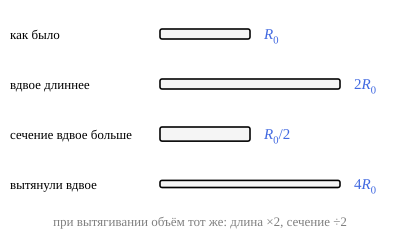

Провода в квартире медные и толстые, а спираль чайника — из нихрома и тонкая. По проводам ток идёт почти без помех, а спираль раскаляется. От чего зависит сопротивление провода и почему оно вообще есть?

## Откуда сопротивление

Вспомни урок 3.1: в металле положительные ионы стоят рядами, а между ними движутся свободные электроны. Поле в проводе разгоняет электрон, но он то и дело налетает на ионы и теряет набранную скорость. Потом поле снова разгоняет его — и снова столкновение. Поэтому электроны дрейфуют медленно, а энергия, которую им передаёт поле, уходит ионам: решётка сильнее колеблется, провод нагревается.

Чем чаще столкновения, тем меньше ток при том же напряжении — тем больше сопротивление.

## Длина, сечение и материал

Опыты с проводами из одного металла показывают:

- провод **вдвое длиннее** — сопротивление **вдвое больше**: электрону на всём пути больше столкновений, а напряжение то же;
- провод с **вдвое большей площадью сечения** — сопротивление **вдвое меньше**: рядом идут вдвое больше электронов, как машины по вдвое более широкой дороге.

Сопротивление пропорционально длине $l$ и обратно пропорционально площади сечения $S$:

$$
R = \rho\,\frac{l}{S}.
$$

Коэффициент $\rho$ («ро») — **удельное сопротивление** — зависит только от материала. Это сопротивление куска провода длиной ${1\ \text{м}}$ и сечением ${1\ \text{м}^2}$, поэтому его единица — ${\text{Ом} \cdot \text{м}}$.

Провода тонкие, и их сечение удобнее мерить в квадратных миллиметрах. Поэтому в таблицах $\rho$ часто дают в ${\text{Ом} \cdot \text{мм}^2/\text{м}}$. Тогда длину подставляют в метрах, а сечение — прямо в ${\text{мм}^2}$, ничего не переводя. Удельное сопротивление некоторых веществ при ${20\ ^\circ\text{C}}$, в ${\text{Ом} \cdot \text{мм}^2/\text{м:}}$

- серебро — $0{,}016$;
- медь — $0{,}017$;
- алюминий — $0{,}028$;
- железо — $0{,}10$;
- нихром — $1{,}1$.

Медь почти так же хороша, как серебро, но намного дешевле — поэтому провода медные. А из нихрома, у которого $\rho$ в шестьдесят с лишним раз больше, делают спирали нагревателей.

**Пример.** Медный провод длиной ${100\ \text{м}}$ и сечением ${2{,}5\ \text{мм}^2}$:

$$
R = \rho\,\frac{l}{S} = 0{,}017 \cdot \frac{100}{2{,}5} = 0{,}68\ \text{Ом}.
$$

Сто метров провода — меньше ома. Поэтому в задачах сопротивлением соединительных проводов обычно пренебрегают.

<pp-task id="ks-ohm-04"></pp-task>

## Провод вытянули

Если проволоку протянуть через волочильный станок, она станет длиннее и тоньше, а **объём** металла ${V = lS}$ останется прежним. Вытянули вдвое — длина выросла вдвое, а сечение вдвое уменьшилось. Оба изменения увеличивают сопротивление:

$$
R' = \rho\,\frac{2l}{S/2} = 4\rho\,\frac{l}{S} = 4R.
$$

Сопротивление выросло **в 4 раза**, а не в 2.

<pp-task id="ks-ohm-11"></pp-task>

Проверь себя: из куска медной проволоки сделали две одинаковые половинки и скрутили их вместе в один провод. Во сколько раз изменилось сопротивление?

Уменьшилось в $4$ раза. Длина стала вдвое меньше — сопротивление вдвое меньше. Сечение стало вдвое больше — ещё вдвое меньше.

## Частые ловушки

- **Забывают, что при вытягивании меняется и сечение.** Объём тот же: длина растёт — сечение уменьшается во столько же раз.
- **Смешивают единицы.** Если $\rho$ в ${\text{Ом} \cdot \text{мм}^2/\text{м}}$, сечение подставляй в ${\text{мм}^2}$, длину — в метрах. Если $\rho$ в ${\text{Ом} \cdot \text{м}}$ — всё в метрах: ${1\ \text{мм}^2 = 10^{-6}\ \text{м}^2.}$
- **Путают площадь сечения и диаметр.** Провод вдвое толще по диаметру имеет вчетверо большую площадь сечения.

## Коротко

- Сопротивление — от столкновений электронов с ионами решётки.
- ${R = \rho l/S}$; $\rho$ зависит только от материала.
- Вытянули в $n$ раз при том же объёме — сопротивление выросло в $n^2$ раз.

Дальше — урок 5.5: как ведут себя резисторы, соединённые друг за другом.
