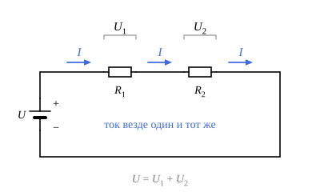

В старой ёлочной гирлянде стоило перегореть одной лампочке — и гасли все. Искать сгоревшую приходилось по одной. Так ведёт себя цепь, в которой приборы соединены друг за другом.

## Один путь — один ток

При **последовательном** соединении проводники стоят друг за другом, без разветвлений: конец первого соединён с началом второго. У тока один путь. Заряд нигде не копится, поэтому сколько его за секунду прошло через первый резистор, столько прошло и через второй (вспомни «Проверь себя» в уроке 5.1). **Сила тока во всех проводниках одна и та же**:

$$
I_1 = I_2 = I.
$$

И понятно, почему гирлянда гаснет целиком: перегоревшая лампочка разрывает единственный путь, и ток прекращается во всей цепи.

## Напряжения складываются

Поле совершает работу над каждым кулоном сначала на первом резисторе, потом на втором. Полная работа — сумма, а напряжение — работа на кулон (урок 5.2). Поэтому **напряжения складываются**:

$$
U = U_1 + U_2.
$$

По закону Ома ${U_1 = IR_1}$ и ${U_2 = IR_2}$, ток один. Подставим: ${U = IR_1 + IR_2 = I(R_1 + R_2)}$. Значит, два резистора действуют как один с сопротивлением

$$
R = R_1 + R_2.
$$

Это **общее** (эквивалентное) сопротивление. Последовательно — как один длинный провод (урок 5.4), поэтому сопротивления складываются, и общее больше любого из них. Для $n$ резисторов — сумма всех $n$.

**Пример.** Резисторы ${30\ \text{Ом}}$ и ${70\ \text{Ом}}$ последовательно подключены к ${9\ \text{В}.}$ Общее сопротивление ${R = 30 + 70 = 100\ \text{Ом}}$, ток

$$
I = \frac{U}{R} = \frac{9}{100} = 0{,}09\ \text{А}.
$$

Напряжения: ${U_1 = 0{,}09 \cdot 30 = 2{,}7\ \text{В}}$, ${U_2 = 0{,}09 \cdot 70 = 6{,}3\ \text{В}.}$ В сумме — ${9\ \text{В}}$, как и должно быть.

<pp-task id="ks-ohm-05"></pp-task>

## Делитель напряжения

Ток один, а ${U_i = IR_i}$. Значит, напряжение делится между резисторами **пропорционально их сопротивлениям**:

$$
\frac{U_1}{U_2} = \frac{R_1}{R_2}.
$$

На большем сопротивлении — большее напряжение. В примере выше ${70 : 30}$ — и напряжения ${6{,}3 : 2{,}7}$, то же отношение. Если резисторы одинаковые, напряжение делится поровну.

Так делят напряжение в электронике, и так устроена гирлянда: одинаковые лампочки делят напряжение сети поровну, и каждая рассчитана на свою долю.

<pp-task id="ks-ohm-12"></pp-task>

## Модель: два резистора

В модели источник и два резистора. Выбери соединение, меняй напряжение источника и сопротивления. Под схемой — таблица: сопротивление, ток и напряжение каждого резистора и всей цепи. Столбец, который одинаков у обоих резисторов, выделен. Чем больше ток, тем толще стрелка.

<pp-circuit>Модель: источник и два резистора, соединённые последовательно или параллельно. Ползунки меняют напряжение источника и сопротивления резисторов; таблица показывает сопротивление, ток и напряжение каждого резистора и всей цепи.</pp-circuit>

Попробуй:

- увеличь $R_2$: что стало с током и с напряжением на $R_1$?
- сделай сопротивления одинаковыми: как поделилось напряжение?
- проверь по таблице, что напряжения на резисторах в сумме дают напряжение источника.

<pp-task id="ks-ohm-13"></pp-task>

Проверь себя: к двум последовательным резисторам добавили третий. Что стало с током в цепи, если напряжение источника то же?

Ток уменьшился. Общее сопротивление — сумма всех трёх, оно выросло, а ${I = U/R}$.

## Частые ловушки

- **Делят напряжение поровну между разными резисторами.** Поровну — только между одинаковыми; иначе пропорционально сопротивлениям.
- **Подставляют в ${I = U_1/R}$ напряжение одного резистора и общее сопротивление.** В закон Ома — величины одного и того же участка: ${U_1}$ и ${R_1}$ или $U$ и $R$.
- **Думают, что ток «тратится» в первом резисторе.** Ток во всех последовательных проводниках одинаковый; тратится энергия.

## Коротко

- Последовательно: ${I_1 = I_2 = I}$, ${U = U_1 + U_2}$, ${R = R_1 + R_2.}$
- Общее сопротивление больше любого из сопротивлений.
- ${U_1/U_2 = R_1/R_2}$: на большем сопротивлении — большее напряжение.

Дальше — урок 5.6: приборы, подключённые к одним и тем же двум точкам.
