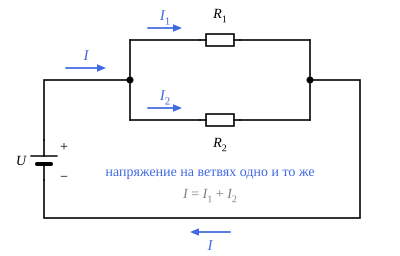

Чайник, холодильник и лампа в квартире работают независимо: выключи один прибор — остальные продолжают работать. Значит, у каждого свой путь для тока. Так устроено параллельное соединение.

## Одно напряжение

При **параллельном** соединении проводники подключены к одним и тем же двум точкам цепи. Точку, где сходятся три провода и больше, называют **узлом** (на схеме — жирная точка). Сопротивлением проводов пренебрегаем (урок 5.4), и тогда все провода, соединённые с одним узлом, — один проводник с одним потенциалом, как соединённые пластины конденсаторов в уроке 4.6. Поэтому **напряжение на всех параллельных проводниках одно и то же**:

$$
U_1 = U_2 = U.
$$

Так и в квартире: каждый прибор подключён к той же паре проводов, и на каждом напряжение сети. Поэтому вольтметр подключают параллельно: на нём то же напряжение, что и на участке.

## Токи складываются

В узле ток разветвляется. Заряд в узле не копится: сколько приходит за секунду, столько и уходит. Поэтому **общий ток — сумма токов в ветвях**:

$$
I = I_1 + I_2.
$$

Напряжение одно, а ${I_i = U/R_i}$. Значит, больше тока идёт по ветви с **меньшим** сопротивлением — как больше воды течёт по более широкой трубе.

## Общее сопротивление

Подставим ${I_i = U/R_i}$ в сумму токов: ${U/R = U/R_1 + U/R_2}$. Напряжение сокращается:

$$
\frac{1}{R} = \frac{1}{R_1} + \frac{1}{R_2}.
$$

Для двух резисторов удобнее сразу:

$$
R = \frac{R_1 R_2}{R_1 + R_2}.
$$

Добавляя ветвь, мы даём току ещё один путь — как будто сечение провода выросло (урок 5.4). Поэтому общее сопротивление параллельного участка **меньше самого маленького** из сопротивлений. Два одинаковых резистора $R$ дают ${R/2}$, а $n$ одинаковых — ${R/n}$.

В уроке 4.6 у конденсаторов было наоборот: параллельно ёмкости складывались, а последовательно складывались обратные величины. У резисторов последовательно складываются сопротивления, а параллельно — обратные.

**Пример.** Резисторы ${10\ \text{Ом}}$ и ${90\ \text{Ом}}$ параллельно подключены к ${9\ \text{В}.}$ Общее сопротивление

$$
R = \frac{10 \cdot 90}{10 + 90} = 9\ \text{Ом}.
$$

Это меньше, чем ${10\ \text{Ом}.}$ Общий ток ${I = 9/9 = 1\ \text{А}.}$ Проверим по ветвям: ${9/10 = 0{,}9\ \text{А}}$ и ${9/90 = 0{,}1\ \text{А}}$, в сумме ${1\ \text{А}.}$ Сходится.

<pp-task id="ks-ohm-06"></pp-task>

## Модель: параллельно

Та же модель, что в уроке 5.5, но резисторы соединены параллельно. Теперь одинаковым у них стало напряжение, а стрелки тока в ветвях разной толщины.

<pp-circuit mode="parallel">Модель: источник и два резистора, соединённые параллельно или последовательно. Ползунки меняют напряжение источника и сопротивления резисторов; таблица показывает сопротивление, ток и напряжение каждого резистора и всей цепи.</pp-circuit>

Попробуй:

- увеличь $R_2$: какая стрелка стала тоньше и что стало с током в $R_1$?
- сделай сопротивления одинаковыми: каким стало общее сопротивление?
- переключи на последовательное соединение при тех же резисторах: где общий ток больше?

<pp-task id="ks-ohm-14"></pp-task>

Проверь себя: в квартире включили ещё один прибор. Что стало с общим сопротивлением и с током в общем проводе?

Приборы включены параллельно. Новая ветвь уменьшает общее сопротивление, а напряжение сети прежнее, поэтому ток в общем проводе вырос — на ток нового прибора. Вот почему нельзя включать в одну розетку слишком много мощных приборов.

## Частые ловушки

- **Складывают сопротивления параллельных резисторов.** Складываются обратные величины; общее — меньше самого маленького.
- **Забывают перевернуть дробь.** Сумма ${1/R_1 + 1/R_2}$ — это ${1/R}$, а не $R$.
- **Думают, что ток делится поровну.** Поровну — только между одинаковыми ветвями; больше тока там, где сопротивление меньше.

## Коротко

- Параллельно: ${U_1 = U_2 = U}$, ${I = I_1 + I_2}$, ${1/R = 1/R_1 + 1/R_2.}$
- Для двух: ${R = R_1R_2/(R_1 + R_2)}$; два одинаковых — ${R/2.}$
- Общее сопротивление меньше самого маленького.

Дальше — урок 5.7: цепи, где есть и то и другое.
