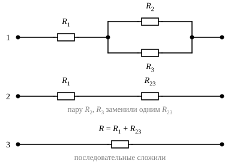

В задачах ЕГЭ резисторы редко стоят просто друг за другом или просто рядом. Чаще — и так и так сразу. Но формул новых не нужно: хватит двух предыдущих уроков и аккуратного порядка действий.

## Свернуть цепь

Главное — найти участки, которые соединены **точно** последовательно или **точно** параллельно:

- последовательно — если между резисторами нет узла, весь ток одного идёт через другой;
- параллельно — если оба конца одного резистора соединены с концами другого, без резисторов между ними.

Такой участок заменяем одним резистором по формулам уроков 5.5 и 5.6. Цепь становится проще, в ней появляются новые такие участки — заменяем и их. И так, пока не останется один резистор.

## Развернуть обратно

Свёрнутая цепь даёт общее сопротивление и, по закону Ома, общий ток. А задача обычно спрашивает о каком-то одном резисторе. Поэтому идём назад по тем же шагам:

1. Сверни цепь до одного резистора $R$.
2. Найди общий ток ${I = U/R}$.
3. На последовательных участках ток тот же — найди напряжение каждого: ${U_i = IR_i}$.
4. На параллельном участке напряжение одно — найди ток каждой ветви: ${I_i = U_\text{уч}/R_i}$.

**Пример.** Резистор ${R_1 = 9\ \text{Ом}}$ соединён последовательно с параллельными ${R_2 = 10\ \text{Ом}}$ и ${R_3 = 15\ \text{Ом}}$ — как на рисунке. Вся цепь подключена к ${4{,}5\ \text{В}.}$ Найдём ток в каждом резисторе.

Свернём. Параллельная пара:

$$
R_{23} = \frac{10 \cdot 15}{10 + 15} = 6\ \text{Ом}.
$$

Она последовательно с $R_1$: ${R = 9 + 6 = 15\ \text{Ом}.}$ Общий ток ${I = 4{,}5/15 = 0{,}3\ \text{А}}$ — он идёт через $R_1$.

Развернём. Напряжение на параллельной паре ${U_{23} = IR_{23} = 0{,}3 \cdot 6 = 1{,}8\ \text{В}.}$ Токи в ветвях:

$$
I_2 = \frac{1{,}8}{10} = 0{,}18\ \text{А}, \qquad I_3 = \frac{1{,}8}{15} = 0{,}12\ \text{А}.
$$

Проверка: ${0{,}18 + 0{,}12 = 0{,}3\ \text{А}}$ — весь ток, и ${U_1 = 0{,}3 \cdot 9 = 2{,}7\ \text{В}}$, а ${2{,}7 + 1{,}8 = 4{,}5\ \text{В}.}$ Сходится.

<pp-task id="ks-ohm-07"></pp-task>

<pp-task id="ks-ohm-15"></pp-task>

Проверь себя: три одинаковых резистора R. Два соединены параллельно, третий — последовательно с ними. Какое общее сопротивление?

Параллельная пара даёт ${R/2}$, вместе с третьим — ${R/2 + R = 1{,}5R.}$

## Частые ловушки

- **Подставляют в закон Ома для одного резистора всё напряжение источника.** На резистор приходится только напряжение его участка.
- **Считают параллельными резисторы, между концами которых есть другой резистор.** Параллельны только те, чьи концы соединены напрямую, через узлы.
- **Останавливаются на общем токе.** Если спрашивают ток в ветви, нужно развернуть цепь обратно.

## Коротко

- Сворачивай: точно последовательные складывай, точно параллельные — по ${1/R = 1/R_1 + 1/R_2.}$
- Общий ток — из ${I = U/R}$.
- Разворачивай: на последовательном участке ток общий, на параллельном — напряжение.

Это последний урок темы. Дальше — тема «ЭДС и закон Ома для полной цепи»: что происходит внутри самого источника.
