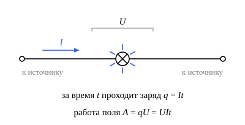

Включи в розетку чайник — вода закипит. Включи вентилятор — закрутятся лопасти. Поставь телефон на зарядку — аккумулятор наберёт энергию. Во всех трёх случаях энергия приходит по проводам. Её переносит ток.

## Ток совершает работу

В уроке 5.2 мы назвали напряжение работой поля на кулон: поле гонит заряды по участку цепи и совершает над ними работу. Эту работу называют **работой тока**. Куда она уходит, зависит от прибора:

- в спирали чайника и в нити лампы — в тепло и свет;
- в электродвигателе — в движение, и немного в тепло;
- в заряжаемом аккумуляторе — в химическую энергию.

Сама энергия берётся у источника: в розетке — у электростанции, в фонарике — у батарейки (урок 6.1).

## Работа через ток и время

Пусть на участке цепи напряжение $U$. Над каждым кулоном поле совершает работу $U$ джоулей, а над зарядом $q$ — в $q$ раз больше (урок 2.5):

$$
A = qU.
$$

Заряд мы обычно не знаем, зато знаем ток. За время $t$ через участок проходит заряд ${q = It}$ (урок 5.1). Подставим:

$$
A = UIt.
$$

- $U$ — напряжение на участке, В;
- $I$ — сила тока в нём, А;
- $t$ — время, с;
- $A$ — работа тока, Дж.

Из формулы видно: ${1\ \text{Дж} = 1\ \text{В} \cdot \text{А} \cdot \text{с}}$. Время всегда подставляй в секундах.

**Пример.** Лампа включена в сеть ${220\ \text{В},}$ через неё идёт ток ${0{,}3\ \text{А}.}$ За ${6\ \text{мин} = 360\ \text{с}}$ через неё проходит заряд ${q = 0{,}3 \cdot 360 = 108\ \text{Кл},}$ и ток совершает работу

$$
A = qU = 108 \cdot 220 = 23\,760\ \text{Дж} \approx 23{,}8\ \text{кДж}.
$$

То же сразу по формуле: ${A = 220 \cdot 0{,}3 \cdot 360 = 23\,760\ \text{Дж}.}$

<pp-task id="ks-power-01"></pp-task>

## Из той же формулы

Если известны работа и два множителя из трёх, третий находят делением. Например, время ${t = A/(UI)}$, ток ${I = A/(Ut)}$. Работу перед этим переведи в джоули — тогда время получится в секундах.

<pp-task id="ks-power-08"></pp-task>

Проверь себя: лампу и вентилятор включили в одну и ту же розетку на одно и то же время. Ток через вентилятор больше. Кто из них получил больше энергии?

Вентилятор. Напряжение у них одно (сеть), время одно, а работа тока ${A = UIt}$ пропорциональна току.

## Частые ловушки

- **Подставляют время в минутах или часах.** В ${A = UIt}$ время в секундах — тогда работа выйдет в джоулях.
- **Путают килоджоули и джоули.** ${1\ \text{кДж} = 1000\ \text{Дж}.}$
- **Берут напряжение всей цепи вместо напряжения на приборе.** В формулу — напряжение и ток одного и того же участка.

## Коротко

- Работа тока на участке: ${A = qU = UIt.}$
- $U$ и $I$ — одного участка, $t$ — в секундах.
- Работа тока уходит в тепло, свет, движение, химическую энергию.

Дальше — урок 7.2: как быстро ток совершает работу.
