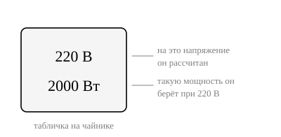

Один чайник рассчитан на ${1\ \text{кВт},}$ другой — на ${2\ \text{кВт}.}$ Воды в них поровну, и нагреть её нужно одинаково. Но второй вскипятит воду примерно вдвое быстрее. Энергии вода получит столько же — разница в том, как быстро чайник её отдаёт. Это и есть мощность.

## Работа за секунду

Мощность мы уже встречали (урок 11.2 из механики): это работа за единицу времени, ${N = A/t}$, в ваттах. В электричестве мощность обозначают буквой $P$. Работа тока ${A = UIt}$ (урок 7.1), поэтому

$$
P = \frac{A}{t} = UI.
$$

- $U$ — напряжение на приборе, В;
- $I$ — сила тока в нём, А;
- $P$ — мощность тока, Вт.

Значит, ${1\ \text{Вт} = 1\ \text{В} \cdot \text{А}}$: мощность в один ватт — это ток в один ампер при напряжении в один вольт. Ещё $U$ — джоули на кулон, а $I$ — кулоны в секунду, и их произведение — джоули в секунду.

Сколько потребляют приборы дома:

- светодиодная лампа — около ${10\ \text{Вт}}$;
- ноутбук — несколько десятков ватт;
- пылесос, утюг, чайник — от ${1}$ до ${2{,}5\ \text{кВт}.}$

## Надпись на приборе

На каждом приборе написано, на какое напряжение он рассчитан и какую мощность при нём потребляет. Это **номинальные** значения. При номинальном напряжении прибор и работает с номинальной мощностью. При другом напряжении мощность будет другой — об этом урок 7.5.

По надписи легко найти ток: ${I = P/U}$.

**Пример.** Для чайника на табличке ${I = 2000/220 \approx 9{,}1\ \text{А}.}$ Это большой ток, поэтому у мощных приборов толстый шнур.

<pp-task id="ks-power-02"></pp-task>

## Работа через мощность

Из ${P = A/t}$ следует, что работа тока за время $t$

$$
A = Pt,
$$

а время ${t = A/P}$ — как в механике. Вот почему чайник на ${2\ \text{кВт}}$ греет вдвое быстрее: та же энергия при вдвое большей мощности набирается за вдвое меньшее время.

Если известны работа тока и время, сначала найди мощность ${P = A/t}$, а по ней — ток ${I = P/U}$.

<pp-task id="ks-power-09"></pp-task>

Проверь себя: почему опасно включать в один удлинитель сразу чайник, утюг и обогреватель?

Все они подключены к сети параллельно, на каждом ${220\ \text{В}.}$ Ток каждого ${I = P/U}$ большой, а в шнуре удлинителя токи складываются (урок 5.6). Чем больше ток, тем сильнее греются провода (урок 5.4), а шнур рассчитан на ограниченный ток.

## Частые ловушки

- **Путают мощность и работу.** Мощность — сколько джоулей за секунду, работа — сколько всего.
- **Подставляют киловатты в ${I = P/U}$ без перевода.** Чтобы ток вышел в амперах, мощность — в ваттах.
- **Считают, что прибор всегда потребляет мощность с надписи.** Только при напряжении с надписи.

## Коротко

- Мощность тока: ${P = A/t = UI}$, в ваттах; ${1\ \text{Вт} = 1\ \text{В} \cdot \text{А}.}$
- По надписи на приборе: ток ${I = P/U}$.
- Работа ${A = Pt}$, время ${t = A/P}$.

Дальше — урок 7.3: за что мы платим по счётчику.
