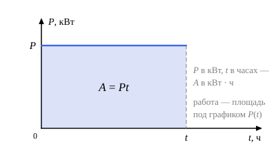

В квитанции за электричество не пишут джоули. Там стоят киловатт-часы, и платим мы за каждый из них. Что это за единица и откуда она взялась?

## Единица энергии для дома

Работа тока ${A = Pt}$ (урок 7.2). Приборы дома мощные, а работают часами. Если считать в ваттах и секундах, числа выйдут огромными. Поэтому мощность берут в киловаттах, время — в часах, и работа выходит в **киловатт-часах**:

$$
1\ \text{кВт} \cdot \text{ч} = 1000\ \text{Вт} \cdot 3600\ \text{с} = 3{,}6 \cdot 10^6\ \text{Дж} = 3{,}6\ \text{МДж}.
$$

Это энергия, которую прибор мощностью ${1\ \text{кВт}}$ потребляет за час. Именно её и считает счётчик.

Не путай: **киловатт** — единица мощности (как быстро), **киловатт-час** — единица энергии (сколько всего). Прибор на ${1\ \text{кВт}}$ за полчаса потребит ${0{,}5\ \text{кВт} \cdot \text{ч}}$, а за два часа — ${2\ \text{кВт} \cdot \text{ч}.}$

**Пример.** Чайник мощностью ${2\ \text{кВт}}$ работает ${18\ \text{мин}.}$ Минуты — в часы: ${18\ \text{мин} = 0{,}3\ \text{ч}.}$ Энергия

$$
A = Pt = 2\ \text{кВт} \cdot 0{,}3\ \text{ч} = 0{,}6\ \text{кВт} \cdot \text{ч}.
$$

В джоулях: ${0{,}6 \cdot 3{,}6 \cdot 10^6 = 2{,}16 \cdot 10^6\ \text{Дж}.}$ Можно проверить и напрямую: ${2000\ \text{Вт} \cdot 1080\ \text{с}}$ дают то же.

<pp-task id="ks-power-05"></pp-task>

## Сколько это стоит

Цену одного киловатт-часа называют тарифом. Чтобы найти стоимость, энергию в киловатт-часах умножают на тариф. Если прибор работает каждый день, сначала сложи часы за весь срок.

**Пример.** При тарифе ${5{,}6\ \text{руб.}}$ за ${1\ \text{кВт} \cdot \text{ч}}$ чайник из примера выше за один раз «съедает» ${0{,}6 \cdot 5{,}6 \approx 3{,}4\ \text{руб.}}$

<pp-task id="ks-power-10"></pp-task>

Проверь себя: что больше — 1 кВт · ч или 1 МДж?

Киловатт-час: ${1\ \text{кВт} \cdot \text{ч} = 3{,}6\ \text{МДж},}$ это больше мегаджоуля в $3{,}6$ раза.

## Частые ловушки

- **Путают кВт и кВт · ч.** Первое — мощность, второе — энергия.
- **Берут мощность в ваттах, а время в часах.** Выйдут ватт-часы — в тысячу раз больше чисел, чем киловатт-часов.
- **Берут время в минутах.** Для киловатт-часов время — в часах: ${30\ \text{мин} = 0{,}5\ \text{ч}.}$

## Коротко

- ${1\ \text{кВт} \cdot \text{ч} = 3{,}6 \cdot 10^6\ \text{Дж}.}$
- Энергия в кВт · ч: мощность в киловаттах умножить на время в часах.
- Стоимость: энергия в кВт · ч умножить на тариф.

Дальше — урок 7.4: сколько теплоты выделяет ток в проводнике.
