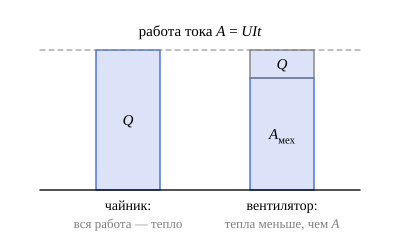

Спираль плитки раскаляется докрасна, а провода, которые подводят к ней ток, почти холодные. А ведь ток в них тот же: цепь последовательная (урок 5.5). Почему одно греется, а другое нет?

## Откуда тепло

Вспомни урок 5.4: поле разгоняет свободные электроны, они налетают на ионы решётки и отдают им энергию. Ионы сильнее колеблются — проводник нагревается. Так работа тока превращается в тепло.

В спирали, в резисторе, в нити лампы вся работа тока уходит в нагрев (а у лампы ещё и в свет, который тоже рождается от раскалённой нити). Тогда теплота равна работе тока: ${Q = UIt.}$ Для проводника по закону Ома ${U = IR}$ (урок 5.3). Подставим:

$$
Q = I^2 R t.
$$

- $I$ — сила тока, А;
- $R$ — сопротивление проводника, Ом;
- $t$ — время, с;
- $Q$ — количество теплоты, Дж.

Это **закон Джоуля — Ленца**. Его открыли опытами в 1840-х годах независимо друг от друга англичанин Джеймс Джоуль и русский физик Эмилий Ленц.

Теперь понятно, почему греется спираль, а не провода. Ток один, а теплота пропорциональна сопротивлению. У медных проводов сопротивление крошечное (урок 5.4), у нихромовой спирали — в сотни раз больше. И заметь: ток стоит **в квадрате**. Ток вдвое больше — тепла вчетверо больше.

**Пример.** Через резистор сопротивлением ${25\ \text{Ом}}$ идёт ток ${0{,}6\ \text{А}.}$ За ${1\ \text{мин}}$ в нём выделится

$$
Q = I^2 R t = 0{,}36 \cdot 25 \cdot 60 = 540\ \text{Дж}.
$$

<pp-task id="ks-power-03"></pp-task>

## Когда тепло меньше работы

У вентилятора, пылесоса, дрели внутри электродвигатель. Работа тока ${A = UIt}$ уходит в нём в основном в движение, а в тепло — только часть. Эта часть по-прежнему ${Q = I^2Rt}$, где $R$ — сопротивление обмотки двигателя.

Поэтому закон Джоуля — Ленца ${Q = I^2Rt}$ верен **всегда**, для любого проводника. А теплота равна ${UIt}$, только если вся работа тока идёт в нагрев — у нагревателей, резисторов, ламп.

## Чайник греет воду

Спираль чайника — нагреватель: всю работу тока она превращает в тепло. При мощности $P$ за время $\tau$ она выделяет ${Q = P\tau}$ — так мы и считали в уроке 5.3 из МКТ (там мощность обозначали $N$). Время там обозначали $\tau$, чтобы не путать с температурой $t$; так сделаем и здесь.

Воде достаётся не всё: часть уходит в корпус и в воздух. Воде нужно ${Q_{\text{пол}} = cm(t_2 - t_1)}$ (урок 5.2 из МКТ), а доля полезной теплоты — КПД нагревателя:

$$
\eta = \frac{Q_{\text{пол}}}{P\tau}.
$$

**Пример.** Чайник мощностью ${2\ \text{кВт}}$ с КПД ${84\,\%}$ нагревает ${1\ \text{кг}}$ воды от ${20\ ^\circ\text{C}}$ до кипения. Воде нужно ${4200 \cdot 1 \cdot 80 = 336\,000\ \text{Дж}.}$ Спираль должна выделить больше: ${336\,000/0{,}84 = 400\,000\ \text{Дж}.}$ Время

$$
\tau = \frac{400\,000}{2000} = 200\ \text{с}.
$$

<pp-task id="ks-power-11"></pp-task>

Проверь себя: два резистора соединены последовательно, сопротивление первого в 5 раз больше. В каком выделяется больше теплоты и во сколько раз?

В первом, в $5$ раз. Ток через них один (урок 5.5), время одно, а ${Q = I^2Rt}$ пропорциональна сопротивлению.

## Частые ловушки

- **Не возводят ток в квадрат.** ${Q = I^2Rt}$, а не ${IRt}$.
- **Считают теплоту в двигателе по ${UIt}$.** Это вся работа тока; в тепло уходит только ${I^2Rt}$.
- **Умножают на КПД вместо деления.** Спираль выделяет больше, чем получает вода: ${P\tau = Q_{\text{пол}}/\eta}$.

## Коротко

- Закон Джоуля — Ленца: ${Q = I^2Rt}$ — верен всегда.
- ${Q = UIt}$, только если вся работа тока идёт в тепло.
- Нагреватель с КПД $\eta$: ${\eta P\tau = cm(t_2 - t_1)}$.

Дальше — урок 7.5: как мощность зависит от сопротивления.
