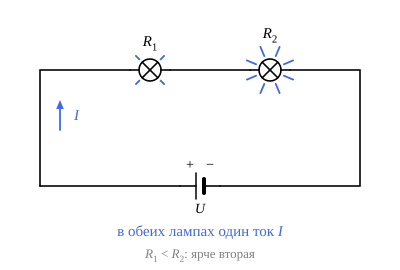

Возьми две лампы на ${220\ \text{В}:}$ на ${60\ \text{Вт}}$ и на ${40\ \text{Вт}.}$ Вкрути их в люстру — ярче горит шестидесятиваттная. А теперь соедини их последовательно и включи в ту же сеть. Ярче загорится… сороковаттная! Как так?

## Что одинаково

Яркость лампы определяет мощность, которая в ней выделяется. Формул мощности три (урок 7.5), и все верны. Удобна та, в которой величина, **одинаковая** для обеих ламп. Тогда сравнение сводится к сопротивлениям. А сопротивление лампы по надписи ${R = U^2/P}$: у лампы на ${40\ \text{Вт}}$ оно больше.

## Параллельно: одно напряжение

При параллельном соединении на обеих лампах одно напряжение (урок 5.6). Удобна формула ${P = U^2/R}$: больше мощность там, где **меньше** сопротивление. В люстре каждая лампа получает напряжение сети, то самое, что написано на цоколе. Поэтому каждая горит со своей номинальной мощностью, и ярче шестидесятиваттная.

## Последовательно: один ток

При последовательном соединении ток в обеих лампах один (урок 5.5). Удобна формула ${P = I^2R}$: больше мощность там, где **больше** сопротивление. Сопротивление больше у сороковаттной — она и горит ярче.

Но номинальной мощности не получает ни одна. Напряжение сети делится между лампами (урок 5.5), и каждой достаётся меньше ${220\ \text{В}.}$ Обе горят тусклее, чем в люстре. Надпись на цоколе — мощность только при номинальном напряжении.

Чтобы найти мощность каждой лампы, иди по шагам: сопротивления по надписям ${R = U^2/P}$, общее сопротивление ${R_1 + R_2,}$ ток в цепи, мощность ${I^2R}$ каждой лампы.

<pp-task id="ks-power-06"></pp-task>

## Сравнение одной строкой

- **Последовательно**: ток один, мощности пропорциональны сопротивлениям, ${P_1/P_2 = R_1/R_2.}$
- **Параллельно**: напряжение одно, мощности обратно пропорциональны сопротивлениям, ${P_1/P_2 = R_2/R_1.}$

И в том, и в другом случае мощность всей цепи — сумма мощностей ламп: энергия никуда не пропадает.

<pp-task id="ks-power-13"></pp-task>

Проверь себя: в гирлянде из одинаковых лампочек, соединённых последовательно, одну лампочку убрали, а провода соединили. Остальные лампочки стали гореть ярче или тусклее?

Ярче. Лампочек стало меньше, общее сопротивление уменьшилось, ток вырос. Мощность каждой ${I^2R}$ выросла, хотя её сопротивление то же. Зато перегорать они будут чаще.

## Частые ловушки

- **Считают, что ярче всегда лампа с большей мощностью на цоколе.** Так только при параллельном включении в сеть с номинальным напряжением.
- **Берут формулу ${U^2/R}$ при последовательном соединении с напряжением всей цепи.** На каждой лампе своё напряжение; надёжнее ${I^2R}$ с общим током.
- **Берут мощность с надписи для лампы, включённой последовательно.** Ей достаётся только часть напряжения.

## Коротко

- Ярче та лампа, в которой выделяется большая мощность.
- Последовательно: один ток, больше мощность на большем $R$.
- Параллельно: одно напряжение, больше мощность на меньшем $R$.

Дальше — урок 7.7: какую долю мощности источник отдаёт во внешнюю цепь.
