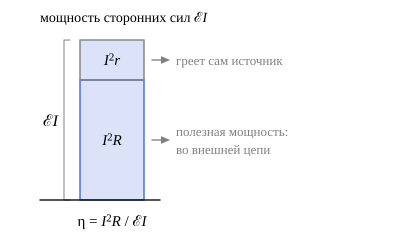

В уроке 6.7 мы выяснили, что часть энергии батарейки остаётся в ней самой теплом. Какая это часть? От чего она зависит — от батарейки или от того, что к ней подключили? Ответ даёт КПД источника.

## Мощности в полной цепи

Мощность сторонних сил источника ${\mathcal{E}I}$ делится на две части (урок 6.7):

$$
\mathcal{E} I = UI + I^2 r.
$$

Пусть внешняя цепь — резистор $R$ (или несколько, сведённых к одному, урок 5.7). Его мощность ${UI = I^2R}$ (урок 7.5). Тогда

$$
\mathcal{E} I = I^2 R + I^2 r.
$$

Правая часть — ${I^2(R + r)}$, а по закону Ома для полной цепи ${I(R + r) = \mathcal{E}}$ (урок 6.2). Всё сходится: сколько мощности развивают сторонние силы, столько и выделяется во внешней цепи и внутри источника вместе.

## КПД источника

Полезная мощность — та, что идёт во внешнюю цепь: в лампу, двигатель, резистор. Затраченная — вся мощность сторонних сил. Их отношение — **КПД источника**:

$$
\eta = \frac{UI}{\mathcal{E} I} = \frac{U}{\mathcal{E}}.
$$

Для внешнего резистора то же через сопротивления:

$$
\eta = \frac{I^2 R}{I^2 (R + r)} = \frac{R}{R + r}.
$$

КПД — та доля ЭДС, что приходится на полюса. На картинке из урока 6.6 это доля нижней части столбика $U$.

**Пример.** Батарейка с ЭДС ${4{,}5\ \text{В}}$ и внутренним сопротивлением ${1\ \text{Ом}}$ питает лампу ${3{,}5\ \text{Ом}.}$ Ток ${I = 4{,}5/(3{,}5 + 1) = 1\ \text{А},}$ напряжение на полюсах ${U = 1 \cdot 3{,}5 = 3{,}5\ \text{В}.}$ КПД

$$
\eta = \frac{U}{\mathcal{E}} = \frac{3{,}5}{4{,}5} \approx 0{,}78 = 78\,\%.
$$

Через мощности то же: сторонние силы ${4{,}5\ \text{Вт},}$ лампа ${1^2 \cdot 3{,}5 = 3{,}5\ \text{Вт},}$ внутри ${1\ \text{Вт}.}$ Больше пятой части мощности греет саму батарейку.

<pp-task id="ks-power-07"></pp-task>

## КПД зависит от нагрузки

КПД — не свойство одной батарейки: в ${R/(R + r)}$ входит и внешнее сопротивление.

- Чем больше $R$ по сравнению с $r$, тем ближе КПД к ${100\,\%.}$ Но и ток при этом маленький.
- При коротком замыкании ${R \approx 0}$ и ${\eta \approx 0}$: вся мощность остаётся в источнике теплом (урок 6.4).

Если известен КПД, а нужно сопротивление, запиши ${\eta = R/(R + r)}$ и реши это уравнение относительно $R$.

<pp-task id="ks-power-14"></pp-task>

Проверь себя: почему хороший источник должен иметь маленькое внутреннее сопротивление?

При маленьком $r$ дробь ${R/(R + r)}$ близка к единице почти при любой нагрузке. Источник мало греется сам, отдаёт почти всю мощность наружу, и напряжение на его полюсах почти равно ЭДС (урок 6.3).

## Частые ловушки

- **Находят долю потерь вместо КПД.** ${r/(R + r)}$ — доля, которая греет источник; КПД — ${R/(R + r)}$.
- **Считают КПД постоянным для данного источника.** Он зависит от нагрузки.
- **Делят полезную мощность на мощность во внешней цепи.** Затраченная мощность — ${\mathcal{E}I}$, вся мощность сторонних сил.

## Коротко

- ${\mathcal{E}I = I^2R + I^2r}$: полезная мощность и нагрев источника.
- КПД источника ${\eta = U/\mathcal{E} = R/(R + r)}$.
- Больше $R$ — выше КПД; при коротком замыкании КПД нулевой.

Дальше — урок 7.8: при какой нагрузке источник отдаёт наружу больше всего мощности.
