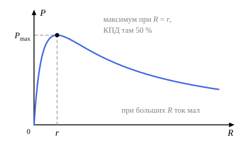

Подключим к батарейке реостат и будем менять его сопротивление. При коротком замыкании ток самый большой, но напряжение на полюсах почти нулевое (урок 6.4): мощность ${UI}$ во внешней цепи — ноль. Если цепь разомкнуть, напряжение равно ЭДС, но тока нет: снова ноль. Значит, где-то между ними внешняя цепь получает больше всего мощности. Где?

## Мощность во внешней цепи

Ток ${I = \mathcal{E}/(R + r)}$ (урок 6.2), мощность во внешнем резисторе ${P = I^2R}$ (урок 7.5):

$$
P = \frac{\mathcal{E}^2 R}{(R + r)^2}.
$$

Возьмём батарейку с ЭДС ${6\ \text{В}}$ и внутренним сопротивлением ${2\ \text{Ом}}$ и посчитаем мощность при трёх нагрузках:

- ${R = 1\ \text{Ом}}$: ${P = 36 \cdot 1/(1 + 2)^2 = 4\ \text{Вт};}$
- ${R = 2\ \text{Ом}}$: ${P = 36 \cdot 2/(2 + 2)^2 = 4{,}5\ \text{Вт};}$
- ${R = 4\ \text{Ом}}$: ${P = 36 \cdot 4/(4 + 2)^2 = 4\ \text{Вт}.}$

Больше всего — при ${R = 2\ \text{Ом},}$ когда внешнее сопротивление равно внутреннему.

## Почему максимум при R = r

Квадрат суммы можно записать так: ${(R + r)^2 = (R - r)^2 + 4Rr.}$ Тогда

$$
P = \frac{\mathcal{E}^2 R}{(R - r)^2 + 4Rr}.
$$

Слагаемое ${(R - r)^2}$ не бывает отрицательным, поэтому знаменатель не меньше ${4Rr}$, а мощность не больше ${\mathcal{E}^2 R/(4Rr)}$:

$$
P_{\max} = \frac{\mathcal{E}^2}{4r}, \quad \text{при}\ R = r.
$$

Что при этом в цепи:

- ток ${I = \mathcal{E}/(2r)}$ — половина тока короткого замыкания;
- на полюсах половина ЭДС: ${U = \mathcal{E}/2}$;
- КПД ${\eta = R/(R + r) = 50\,\%}$ (урок 7.7): ровно столько же мощности греет сам источник.

<pp-task id="ks-power-15"></pp-task>

## Модель: мощность и КПД

В модели — батарейка с ЭДС ${6\ \text{В}}$ и внутренним сопротивлением ${2\ \text{Ом}}$ на реостате, как в уроке 6.6. Двигай реостат от короткого замыкания до ${12\ \text{Ом}.}$ В таблице — ток, мощность во внешней цепи, нагрев источника и КПД. Под схемой — график мощности во внешней цепи, точка показывает, где ты сейчас.

<pp-source show="power">Модель: батарейка с ЭДС 6 В и внутренним сопротивлением 2 Ом замкнута на реостат через амперметр, вольтметр подключён к её полюсам. Ползунок меняет сопротивление реостата от нуля до 12 Ом; таблица показывает ток, мощность во внешней цепи, мощность нагрева батарейки и КПД, график — мощность во внешней цепи от сопротивления реостата с максимумом при R = r.</pp-source>

Попробуй:

- найди положение реостата, при котором точка на графике выше всего: какой там КПД?
- поставь реостат на ноль: куда уходит вся мощность сторонних сил?
- сравни нагрев источника и мощность во внешней цепи при малом и при большом сопротивлении реостата.

## Максимум мощности или высокий КПД

На максимуме мощности половина энергии греет источник. Электростанциям и аккумуляторам это невыгодно: им нужен высокий КПД, поэтому нагрузку делают намного больше внутреннего сопротивления (урок 7.7). А там, где источник слабый и важно выжать из него побольше, нагрузку подбирают равной внутреннему сопротивлению. Так согласуют, например, антенну с приёмником.

Проверь себя: к источнику с внутренним сопротивлением 4 Ом подключают то резистор 2 Ом, то резистор 8 Ом. В каком случае мощность во внешней цепи больше?

Одинаковая. ${\mathcal{E}^2 \cdot 2/6^2 = \mathcal{E}^2/18}$ и ${\mathcal{E}^2 \cdot 8/12^2 = \mathcal{E}^2/18.}$ Так бывает всегда, когда ${R_1 R_2 = r^2}$: на графике это две точки одной высоты по разные стороны от максимума.

## Частые ловушки

- **Думают, что наибольшая мощность — при коротком замыкании.** Ток там самый большой, но напряжение на полюсах почти нулевое.
- **Думают, что на максимуме мощности и КПД наибольший.** На максимуме КПД всего ${50\,\%.}$
- **Забывают четвёрку в ${P_{\max} = \mathcal{E}^2/(4r)}$.** ${\mathcal{E}^2/r}$ — это ${\mathcal{E} I_{\text{кз}}}$, такой мощности внешняя цепь не получает никогда.

## Коротко

- Мощность во внешней цепи ${P = \mathcal{E}^2 R/(R + r)^2.}$
- Наибольшая при ${R = r}$: ${P_{\max} = \mathcal{E}^2/(4r),}$ ${U = \mathcal{E}/2,}$ КПД ${50\,\%.}$
- Нагрузки с ${R_1 R_2 = r^2}$ получают одинаковую мощность.

Это последний урок темы. Дальше — тема «Магнитное поле и сила Ампера»: ток не только греет проводник, но и создаёт вокруг него магнитное поле.
