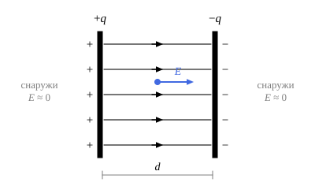

Вспышка фотоаппарата заряжается пару секунд, а потом отдаёт энергию за тысячную долю секунды. Внутри — конденсатор. Тема нужна в задачах 11, 14, 15, а также в задачах 23 и 25.

Конденсаторы разбирают в 10 классе — сразу после поля и потенциала. Пригодятся темы «Напряжённость и потенциал» (однородное поле, $U = Ed$) и «Проводники и диэлектрики» (диэлектрическая проницаемость).

## Шаг 1. Конденсатор и электроёмкость (10 класс)

**Конденсатор** — два проводника (обкладки), разделённые слоем диэлектрика. На обкладках равные по модулю и противоположные по знаку заряды $+q$ и $-q$. Зарядом конденсатора называют $q$ — заряд одной обкладки.

**Электроёмкость** показывает, какой заряд нужно сообщить, чтобы напряжение между обкладками стало $1\ \text{В}$:

$$
C = \frac{q}{U}.
$$

Единица — фарад (Ф). Фарад — огромная ёмкость, обычно встречаются мкФ ($10^{-6}$), нФ ($10^{-9}$), пФ ($10^{-12}$).

Ёмкость не зависит от заряда и напряжения — только от устройства конденсатора.

<pp-task id="ks-cap-01"></pp-task>

## Шаг 2. Плоский конденсатор (10 класс)

Две параллельные пластины площадью $S$ на расстоянии $d$:

$$
C = \frac{\varepsilon\varepsilon_0 S}{d}.
$$

- $\varepsilon_0 = 8{,}85 \cdot 10^{-12}\ \text{Ф/м}$ — электрическая постоянная;
- $\varepsilon$ — диэлектрическая проницаемость вещества между пластинами;
- $S$ — площадь пластины, $\text{м}^2$; $d$ — расстояние, м.

<pp-task id="ks-cap-02"></pp-task>

## Шаг 3. От чего зависит ёмкость (10 класс)

По формуле шага 2:

- пластины **раздвинули** — ёмкость **уменьшилась** (во столько же раз, во сколько выросло $d$);
- площадь пластин увеличили — ёмкость выросла;
- между пластинами вставили диэлектрик — ёмкость выросла в $\varepsilon$ раз.

Если меняется сразу несколько величин, перемножь их влияния.

<pp-task id="ks-cap-03"></pp-task>

## Шаг 4. Поле внутри конденсатора (10 класс)

Поле внутри плоского конденсатора однородное, и из темы «Напряжённость и потенциал»:

$$
E = \frac{U}{d}.
$$

Снаружи пластин поле почти равно нулю: поля положительной и отрицательной обкладок там гасят друг друга.

<pp-task id="ks-cap-04"></pp-task>

## Шаг 5. Энергия конденсатора (10 класс)

Заряженный конденсатор запасает энергию электрического поля:

$$
W = \frac{q U}{2} = \frac{C U^2}{2} = \frac{q^2}{2C}.
$$

Три формулы — одна и та же энергия, переходить между ними помогает $q = CU$. Выбирай форму по тому, что известно или что постоянно в задаче.

<pp-task id="ks-cap-05"></pp-task>

## Шаг 6. Отключён или подключён? (10 класс)

Это главный вопрос задач 15 «как изменятся величины».

- **Конденсатор отключён от источника** — заряд $q$ не может уйти, $q = \text{const}$. Удобна формула $W = q^2/(2C)$.
- **Конденсатор подключён к источнику** — напряжение задаёт источник, $U = \text{const}$. Удобна формула $W = CU^2/2$.

Пример: пластины отключённого конденсатора раздвинули вдвое. $C$ уменьшилась вдвое, $q$ та же, $U = q/C$ выросло вдвое, $E = U/d$ не изменилась, энергия $q^2/(2C)$ выросла вдвое.

<pp-task id="ks-cap-06"></pp-task>

## Шаг 7. Соединения конденсаторов (10 класс)

**Параллельно** — у всех одинаковое напряжение, заряды складываются:

$$
C = C_1 + C_2.
$$

**Последовательно** — у всех одинаковый заряд, напряжения складываются:

$$
\frac{1}{C} = \frac{1}{C_1} + \frac{1}{C_2}.
$$

Заметь: формулы «наоборот» по сравнению с резисторами (тема «Закон Ома»). Последовательная батарея имеет ёмкость меньше самой маленькой из ёмкостей.

<pp-task id="ks-cap-07"></pp-task>

## Шаг 8. Конденсатор в цепи постоянного тока (10 класс)

Конденсатор не пропускает постоянный ток: между обкладками диэлектрик. Подключи его к батарейке — ток пойдёт лишь короткое время, пока конденсатор заряжается, а потом прекратится. Поэтому в задачах на цепи постоянного тока ветвь с заряженным конденсатором считают разорванной, а напряжение на конденсаторе равно напряжению на участке, к которому он подключён параллельно.

Конденсатор умеет быстро отдать накопленную энергию. На этом работают вспышки, дефибрилляторы и сглаживающие фильтры в блоках питания.

## Частые ловушки

- **Забывают, отключён ли конденсатор.** От этого зависит, что постоянно: $q$ или $U$.
- **Путают формулы соединений** с формулами для резисторов.
- **Не переводят приставки.** мкФ, нФ, пФ — это $10^{-6}$, $10^{-9}$, $10^{-12}$.
- **Думают, что ёмкость зависит от заряда.** $C = q/U$ — определение, а зависит ёмкость от $S$, $d$, $\varepsilon$.

## Как это выглядит на ЕГЭ

*Конденсатор ёмкостью $20\ \text{мкФ}$ заряжен до напряжения $100\ \text{В}$. Чему равна энергия конденсатора?*

$$
W = \frac{C U^2}{2} = \frac{20 \cdot 10^{-6} \cdot 100^2}{2} = 0{,}1\ \text{Дж}.
$$

Заряд при этом $q = CU = 2 \cdot 10^{-3}\ \text{Кл}$. Проверим другой формулой: $qU/2 = 2 \cdot 10^{-3} \cdot 100/2 = 0{,}1\ \text{Дж}$.

## Коротко

- $C = q/U$; плоский: $C = \varepsilon\varepsilon_0 S/d$; внутри $E = U/d$.
- $W = qU/2 = CU^2/2 = q^2/(2C)$.
- Отключён — $q = \text{const}$; подключён — $U = \text{const}$.
- Параллельно: $C = C_1 + C_2$; последовательно: $1/C = 1/C_1 + 1/C_2$.
- Постоянный ток через конденсатор не идёт.
