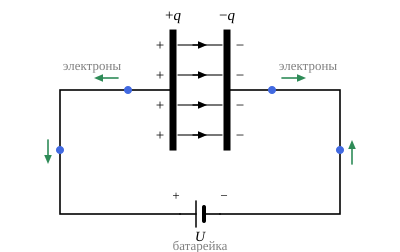
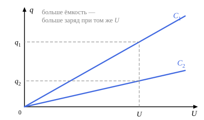

Заряженный шар из урока 3.4 держит заряд, но немного: стоит зарядить его посильнее, и поле у поверхности начнёт пробивать воздух. А как запасти много заряда при небольшом напряжении? Нужно поставить рядом второй проводник с зарядом противоположного знака. Так устроен конденсатор.

## Две обкладки и диэлектрик

**Конденсатор** — два проводника, разделённые слоем диэлектрика. Проводники называют **обкладками**. Чаще всего это две металлические пластины, а между ними воздух, бумага или пластик.

Подключим обкладки к батарейке. Батарейка забирает свободные электроны с обкладки, соединённой с её плюсом, и отдаёт столько же электронов обкладке, соединённой с минусом. Электроны не рождаются и не исчезают (урок 1.3): одна обкладка теряет ровно столько, сколько получает другая. Поэтому заряды обкладок равны по модулю и противоположны по знаку: $+q$ и $-q$.

Через диэлектрик между обкладками заряд пройти не может. Электроны идут по проводам лишь короткое время, пока конденсатор заряжается. Потом ток прекращается, а заряды остаются на обкладках, даже если отключить батарейку.

**Зарядом конденсатора** называют заряд $q$ одной обкладки (положительной), а не сумму: сумма $q + (-q)$ всегда ноль. **Напряжение на конденсаторе** $U$ — напряжение между обкладками (урок 2.5).

## Заряд растёт вместе с напряжением

Возьми батарейку вдвое большего напряжения — на обкладки перейдёт вдвое больший заряд. Причина в принципе суперпозиции (урок 2.4): вдвое больший заряд создаёт вдвое более сильное поле, а значит, и вдвое большее напряжение. Заряд и напряжение пропорциональны: ${q \sim U}$.

Отношение заряда к напряжению у данного конденсатора одно и то же. Его называют **электроёмкостью** (или просто ёмкостью):

$$
C = \frac{q}{U}, \qquad q = CU.
$$

Ёмкость показывает, какой заряд нужно перенести, чтобы напряжение выросло на $1\ \text{В}$. Это как ведро: заряд — количество воды, напряжение — её уровень, ёмкость — ширина ведра. В широкое ведро помещается больше воды при том же уровне.

Ёмкость не зависит ни от заряда, ни от напряжения — только от устройства конденсатора: размеров обкладок, расстояния между ними и диэлектрика. Об этом урок 4.3.

## Фарад и его доли

Единица ёмкости — **фарад** (Ф), в честь Майкла Фарадея: ${1\ \text{Ф} = 1\ \text{Кл/В}}$. Ёмкость $1\ \text{Ф}$ огромна — в уроке 4.3 увидим, насколько. Обычно встречаются:

- микрофарад: ${1\ \text{мкФ} = 10^{-6}\ \text{Ф}}$;
- нанофарад: ${1\ \text{нФ} = 10^{-9}\ \text{Ф}}$;
- пикофарад: ${1\ \text{пФ} = 10^{-12}\ \text{Ф}}$.

Удобно: если ёмкость в микрофарадах, а напряжение в вольтах, то ${q = CU}$ сразу получается в микрокулонах.

**Пример.** Конденсатор ёмкостью $47\ \text{мкФ}$ подключили к батарейке ${9\ \text{В}.}$ Его заряд

$$
q = CU = 47\ \text{мкФ} \cdot 9\ \text{В} = 423\ \text{мкКл}.
$$

<pp-task id="ks-cap-01"></pp-task>

Проверь себя: что больше — 1 мкФ или 1000 пФ?

$1\ \text{мкФ}$. В микрофараде миллион пикофарад ($10^{-6} : 10^{-12} = 10^6$), а $1000\ \text{пФ}$ — это ${1\ \text{нФ} = 0{,}001\ \text{мкФ}.}$

<pp-task id="ks-cap-08"></pp-task>

## Частые ловушки

- **Складывают заряды обкладок.** Сумма всегда ноль; заряд конденсатора — заряд одной обкладки.
- **Думают, что ёмкость зависит от заряда или напряжения.** Формула ${C = q/U}$ — способ её найти, а зависит ёмкость от устройства конденсатора.
- **Не переводят приставки.** мкФ, нФ, пФ — это $10^{-6}$, $10^{-9}$ и ${10^{-12}\ \text{Ф}.}$

## Коротко

- Конденсатор — две обкладки с зарядами $+q$ и $-q$, между ними диэлектрик.
- ${C = q/U}$; ёмкость зависит только от устройства конденсатора.
- ${1\ \text{Ф} = 1\ \text{Кл/В}}$ — очень много; обычно мкФ, нФ, пФ.

Дальше — урок 4.2: какое поле внутри плоского конденсатора.
