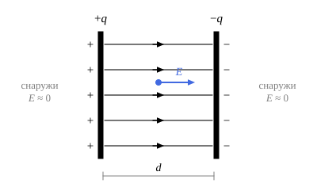

В уроке 2.4 мы видели, что между двумя разноимённо заряженными пластинами поле однородное. Это и есть самый простой конденсатор — **плоский**: две одинаковые параллельные пластины, расстояние $d$ между которыми гораздо меньше их размеров. Разберёмся, почему поле у него сидит внутри, и найдём, чему оно равно.

## Поле одной пластины

Начнём с одной большой равномерно заряженной пластины. Её поле однородное **по обе стороны**: от положительной пластины оно направлено прочь с обеих сторон, к отрицательной — с обеих сторон к ней. И, что удивительно, оно не ослабевает при удалении от пластины, пока мы далеко от её краёв.

Почему не ослабевает? Отходя от пластины, мы удаляемся от каждого её заряда, и поле каждого слабеет. Зато поля далёких зарядов, которые вблизи пластины были направлены почти вдоль неё и гасили друг друга, теперь всё больше направлены прочь от пластины и добавляются к сумме. Эти два эффекта в точности компенсируют друг друга — это доказывают сложением полей всех зарядов пластины.

## Внутри складываются, снаружи гасятся

Теперь две пластины с зарядами $+q$ и $-q$. По принципу суперпозиции (урок 2.4) их поля складываются как векторы.

- **Между пластинами** оба поля направлены в одну сторону — от плюса к минусу — и складываются.
- **Снаружи** поля пластин равны по модулю и направлены противоположно — их сумма ноль.

Поэтому всё поле конденсатора сосредоточено между пластинами, и там оно однородное. Только у краёв пластин линии выгибаются наружу, но если пластины большие и близкие, это мелочь.

Поле тем сильнее, чем гуще сидит заряд на пластине — чем больше заряда приходится на каждый квадратный сантиметр. Это пригодится в уроке 4.3.

## Поле и напряжение

Поле внутри однородное, а для однородного поля мы знаем связь с напряжением (урок 2.6):

$$
E = \frac{U}{d}.
$$

Здесь $U$ — напряжение на конденсаторе, $d$ — расстояние между пластинами в метрах.

**Пример.** Пластины, между которыми ${0{,}5\ \text{мм}}$, подключили к источнику ${12\ \text{В}.}$ Поле внутри:

$$
E = \frac{U}{d} = \frac{12}{5 \cdot 10^{-4}} = 24\ 000\ \text{В/м} = 24\ \text{кВ/м}.
$$

Небольшое напряжение даёт сильное поле, если пластины близко. Поэтому конденсаторы делают с тонким слоем диэлектрика. Но и слишком тонким его не сделаешь: при очень сильном поле диэлектрик **пробивает** — через него проскакивает искра, и конденсатор портится. Поэтому на конденсаторах пишут наибольшее допустимое напряжение.

<pp-task id="ks-cap-04"></pp-task>

Проверь себя: электрон находится между пластинами конденсатора — сначала посередине, потом у самой пластины. Где на него действует большая сила?

Сила одинакова. Поле между пластинами однородное, поэтому ${F = eE}$ везде одна и та же (урок 2.2) — в отличие от поля точечного заряда.

<pp-task id="ks-cap-09"></pp-task>

## Частые ловушки

- **Оставляют миллиметры.** В ${E = U/d}$ расстояние — в метрах.
- **Думают, что снаружи конденсатора такое же поле.** Снаружи поля пластин гасят друг друга.
- **Считают, что у пластины поле сильнее, чем посередине.** Внутри конденсатора поле однородное.

## Коротко

- Плоский конденсатор — две параллельные пластины, расстояние между ними мало по сравнению с размерами.
- Поля пластин между ними складываются, снаружи гасятся: поле есть только внутри, и оно однородное.
- ${E = U/d}$.

Дальше — урок 4.3: от чего зависит ёмкость плоского конденсатора.
