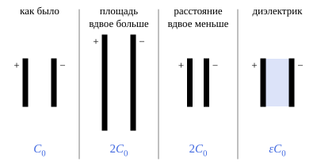

В уроке 4.1 мы сказали, что ёмкость зависит только от устройства конденсатора. Теперь узнаем, как именно. Логика одна: ёмкость ${C = q/U}$ тем больше, чем **меньшее напряжение** получается при том же заряде.

## Три способа увеличить ёмкость

Пусть на пластинах заряды $+q$ и $-q$. Напряжение между ними ${U = Ed}$ (урок 4.2). Посмотрим, что его уменьшает.

- **Увеличим площадь пластин.** Тот же заряд распределится по большей площади — на каждый квадратный сантиметр придётся меньше заряда, и поле станет слабее (урок 4.2). Вдвое больше площадь — вдвое слабее поле, вдвое меньше напряжение, вдвое больше ёмкость: ${C \sim S}$.
- **Сблизим пластины.** Заряд на каждом сантиметре прежний, значит, и поле прежнее. Но напряжение ${U = Ed}$ меньше, раз меньше $d$. Вдвое ближе — вдвое больше ёмкость: ${C \sim 1/d}$.
- **Вставим диэлектрик.** Он поляризуется, и поле внутри него слабее в $\varepsilon$ раз (урок 3.7). Значит, и напряжение в $\varepsilon$ раз меньше, а ёмкость в $\varepsilon$ раз больше.

Всё вместе даёт формулу ёмкости плоского конденсатора:

$$
C = \frac{\varepsilon \varepsilon_0 S}{d}.
$$

- $S$ — площадь одной пластины, $\text{м}^2$;
- $d$ — расстояние между пластинами, м;
- $\varepsilon$ — диэлектрическая проницаемость вещества между пластинами (у воздуха ${\varepsilon = 1}$);
- ${\varepsilon_0 = 8{,}85 \cdot 10^{-12}\ \text{Ф/м}}$ — **электрическая постоянная**.

Постоянная $\varepsilon_0$ — родственница $k$ из закона Кулона: ${k = 1/(4\pi\varepsilon_0)}$. Проверь: ${4\pi \cdot 8{,}85 \cdot 10^{-12} \approx 1{,}11 \cdot 10^{-10}}$, и обратное число как раз ${9 \cdot 10^9.}$

Если меняется сразу несколько величин, перемножь их влияния: каждая входит в формулу множителем.

## Фарад — это очень много

**Пример.** Воздушный конденсатор из пластин площадью ${1\ \text{м}^2}$ на расстоянии ${1\ \text{мм:}}$

$$
C = \frac{\varepsilon_0 S}{d} = \frac{8{,}85 \cdot 10^{-12} \cdot 1}{10^{-3}} = 8{,}85 \cdot 10^{-9}\ \text{Ф}.
$$

Это меньше $9\ \text{нФ}$ — от квадратного метра металла! Чтобы получить $1\ \text{Ф}$ при том же зазоре, понадобились бы пластины площадью около ${10^8\ \text{м}^2}$ — квадраты со стороной больше десяти километров.

Поэтому в настоящих конденсаторах длинные ленты фольги, разделённые тончайшей плёнкой диэлектрика с большой $\varepsilon$, сворачивают в рулон. А в старых радиоприёмниках станцию настраивали конденсатором, у которого ручка поворачивала одни пластины относительно других и меняла площадь их перекрытия — а с ней ёмкость.

<pp-task id="ks-cap-02"></pp-task>

<pp-task id="ks-cap-03"></pp-task>

Проверь себя: почему у конденсатора с водой между пластинами ёмкость в 81 раз больше, чем у такого же воздушного?

У воды ${\varepsilon = 81}$ (урок 3.7). Её молекулы поворачиваются в поле, и связанные заряды ослабляют поле в $81$ раз. При том же заряде напряжение в $81$ раз меньше, а ёмкость ${C = q/U}$ в $81$ раз больше.

<pp-task id="ks-cap-10"></pp-task>

## Частые ловушки

- **Путают направление.** Пластины раздвинули — ёмкость уменьшилась, сблизили — выросла.
- **Делят на $\varepsilon$.** Поле в диэлектрике слабее в $\varepsilon$ раз, а ёмкость — больше: $\varepsilon$ в числителе.
- **Не переводят единицы.** Площадь — в ${\text{м}^2}$ ${(1\ \text{см}^2 = 10^{-4}\ \text{м}^2)}$, расстояние — в метрах.

## Коротко

- ${C = \varepsilon\varepsilon_0 S/d}$, ${\varepsilon_0 = 8{,}85 \cdot 10^{-12}\ \text{Ф/м}.}$
- Больше площадь, меньше расстояние, есть диэлектрик — больше ёмкость.
- Фарад огромен: квадратный метр пластин на миллиметре даёт меньше $9\ \text{нФ}$.

Дальше — урок 4.4: какую энергию запасает конденсатор.
