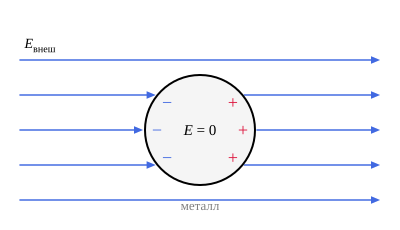

Почему в лифте пропадает связь? Почему во время грозы безопасно сидеть в машине? Ответ — в поведении проводников в электрическом поле. Тема встречается в задаче 14 и в качественной задаче 21.

Что бывают проводники и диэлектрики, рассказывают в 8 классе. Как они ведут себя в электрическом поле — в 10. Пригодится тема «Напряжённость и потенциал»: поле и потенциал заряженного шара считаются по её формулам.

## Шаг 1. Проводники и диэлектрики (8 класс)

Коснись заряженным электроскопом металлической линейки — заряд уйдёт по ней в руку. Коснись пластмассовой — останется на месте. Вещества, по которым заряд может перемещаться, — **проводники** (металлы, растворы солей, тело человека). Вещества, по которым почти не может, — **диэлектрики** (стекло, пластик, сухое дерево, воздух).

Разница — в строении. В металле есть **свободные электроны**: они оторвались от своих атомов и могут перемещаться по всему объёму. В диэлектрике все электроны крепко связаны со своими молекулами.

## Шаг 2. Электростатическая индукция: внутри поля нет (10 класс)

Внесём металлический шар в электрическое поле. Электроны сдвинутся против поля и соберутся на одной стороне, а на другой стороне останется положительный заряд. Это **электростатическая индукция**.

Сдвигаются они до тех пор, пока их собственное поле не скомпенсирует внешнее. В итоге:

- **внутри проводника** напряжённость поля равна нулю: $E = 0$;
- заряд проводника располагается только **на его поверхности**;
- у поверхности линии поля перпендикулярны поверхности.

<pp-task id="ks-cond-01"></pp-task>

## Шаг 3. Поле снаружи заряженного шара (10 класс)

Снаружи заряженного металлического шара поле такое же, как у точечного заряда, помещённого в его центр:

$$
E = k\,\frac{|Q|}{r^2}, \qquad r \ge R,
$$

где $r$ — расстояние **от центра** шара. Если в условии дано расстояние от поверхности, прибавь радиус.

<pp-task id="ks-cond-02"></pp-task>

## Шаг 4. Потенциал проводника одинаков (10 класс)

Внутри проводника $E = 0$, поэтому при перемещении заряда внутри него поле работы не совершает. Значит, весь проводник имеет **одинаковый потенциал** — и поверхность, и центр.

Для шара радиусом $R$ с зарядом $Q$ этот потенциал равен потенциалу на поверхности:

$$
\varphi = k\,\frac{Q}{R}.
$$

Поля внутри нет, а потенциал есть — и он не ноль.

<pp-task id="ks-cond-03"></pp-task>

## Шаг 5. Проводники, соединённые проводом (10 класс)

Соедини два заряженных металлических шара тонкой проволокой — получится один проводник. Заряды перетекут так, чтобы **потенциалы сравнялись**:

$$
k\frac{q_1}{R_1} = k\frac{q_2}{R_2},
\qquad q_1 + q_2 = Q.
$$

Заряды делятся пропорционально радиусам: на большом шаре заряда больше. Для одинаковых шаров получается знакомое «поровну» из темы «Закон Кулона».

<pp-task id="ks-cond-04"></pp-task>

## Шаг 6. Защита и электризация через влияние (10 класс)

Раз внутри проводника поля нет, то и внутри полости в проводнике поля нет. Металлическая оболочка экранирует внешнее электрическое поле. Это **электростатическая защита**: так защищают чувствительные приборы. По той же причине металлический кузов автомобиля защищает от удара молнии (хотя там важна и другая физика — ток идёт по поверхности кузова).

Индукция позволяет зарядить тело без прикосновения. Поднеси заряженную палочку к металлическому шару, не касаясь. На ближней стороне шара соберётся заряд противоположного знака, на дальней — того же. Если в этот момент коснуться шара пальцем (заземлить), заряд того же знака уйдёт в землю. Убери палец, потом палочку — шар останется заряженным, и знак будет **противоположным** знаку палочки.

## Шаг 7. Диэлектрик в поле (10 класс)

В диэлектриках свободных зарядов почти нет. Но и они реагируют на поле: молекулы **поляризуются** — их положительные и отрицательные части немного смещаются или поворачиваются вдоль поля. На поверхности диэлектрика появляются связанные заряды, и их поле частично ослабляет внешнее.

Насколько диэлектрик ослабляет поле, показывает **диэлектрическая проницаемость** $\varepsilon$:

$$
E = \frac{E_0}{\varepsilon}.
$$

У воды $\varepsilon \approx 81$, у стекла около $7$, у воздуха практически $1$. Поле точечного заряда в диэлектрике: $E = k|Q|/(\varepsilon r^2)$ — отсюда и ослабление силы Кулона в $\varepsilon$ раз.

<pp-task id="ks-cond-05"></pp-task>

## Шаг 8. Почему заряженный шарик притягивает бумажки (10 класс)

Бумажка не заряжена. Но в поле шарика она поляризуется: ближе к шарику оказывается заряд противоположного знака, дальше — того же. Поле шарика сильнее вблизи, поэтому притяжение ближнего заряда больше отталкивания дальнего. Итог — бумажка притягивается. Так притягиваются к любому заряженному телу и проводники (из-за индукции), и диэлектрики (из-за поляризации).

## Частые ловушки

- **Думают, что внутри заряженного проводника есть поле.** В равновесии — нет.
- **Считают, что потенциал внутри проводника равен нулю.** Ноль — напряжённость, а потенциал такой же, как на поверхности.
- **Считают, что заряд распределён по объёму металлического шара.** Только по поверхности.
- **Путают электризацию через влияние и через касание.** При касании знак тот же, через влияние с заземлением — противоположный.
- **Считают, что незаряженное тело не притягивается к заряженному.** Притягивается — из-за поляризации или индукции.

## Как это выглядит на ЕГЭ

*Металлический шар радиусом $10\ \text{см}$ несёт заряд $2\ \text{нКл}$. Чему равна напряжённость поля в точке на расстоянии $5\ \text{см}$ от центра шара?*

Точка находится **внутри** проводника ($5 < 10\ \text{см}$). Внутри проводника в равновесии поле равно нулю. Ответ: $0$.

Если бы спросили про точку на расстоянии $20\ \text{см}$ от центра, считали бы как для точечного заряда в центре:

$$
E = 9 \cdot 10^9 \cdot \frac{2 \cdot 10^{-9}}{0{,}04} = 450\ \text{В/м}.
$$

## Коротко

- Внутри проводника в равновесии $E = 0$, потенциал везде одинаков, заряд — на поверхности.
- Снаружи шара поле как у точечного заряда в центре; потенциал шара $kQ/R$.
- Соединённые проводники: потенциалы равны.
- Металлическая оболочка экранирует внешнее поле.
- Диэлектрик поляризуется и ослабляет поле в $\varepsilon$ раз.
- Незаряженные тела притягиваются к заряженным из-за индукции или поляризации.
