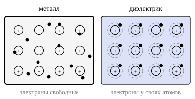

Заряди электроскоп (урок 1.1) — его листочки разойдутся. Теперь коснись его шарика металлической линейкой, держа её в руке. Листочки сразу опадут: заряд ушёл по линейке в руку, а через тело — в землю. Коснись шарика пластмассовой линейкой — листочки так и останутся разведёнными. Почему металл отвёл заряд, а пластмасса нет?

## Проводники и диэлектрики

Вещества, по которым заряд может перемещаться, называют **проводниками**. Вещества, по которым он почти не перемещается, — **диэлектриками** (или изоляторами).

- Проводники: все металлы, графит (грифель карандаша), растворы солей, кислот и щелочей в воде, тело человека, влажная земля.
- Диэлектрики: стекло, пластмассы, резина, янтарь, фарфор, сухое дерево, сухой воздух.

Поэтому у электроскопа металлический стержень проходит через корпус в пробке из диэлектрика: иначе заряд стёк бы на корпус. А провода покрывают резиной или пластиком: по металлу внутри течёт ток, а изоляция не даёт ему уйти в руку.

Деление не абсолютное. Чистая вода — плохой проводник, а вода из-под крана, в которой растворены соли, проводит. Сухое дерево — диэлектрик, мокрое уже проводит. Поэтому электроприборы нельзя трогать мокрыми руками.

## Почему так: свободные электроны

Вспомни урок 1.2: атом — это положительное ядро и электроны вокруг него. Разница между проводником и диэлектриком — в том, как электроны держатся за свои атомы.

В **металле** часть электронов оторвалась от своих атомов. Эти **свободные электроны** бродят по всему куску металла, а атомы, потерявшие электроны, — положительные ионы — остаются на местах и выстраиваются рядами. В целом металл не заряжен: свободных электронов ровно столько, сколько не хватает ионам. Но стоит поднести к металлу заряд, как свободные электроны двинутся: к положительному заряду или от отрицательного. Так заряд и «течёт» по проводнику.

В **диэлектрике** свободных электронов почти нет: каждый электрон крепко держится за свой атом или молекулу. Сдвинуть его далеко нельзя, поэтому заряд, попавший на диэлектрик, остаётся там, куда попал. Именно поэтому трением электризуют стекло, эбонит и пластмассу: заряд на них не растекается и не уходит в руку. А металлический стержень, если держать его в руке, при трении не зарядится: заряд уйдёт через тело.

Проверь себя: почему стеклянная палочка, натёртая шёлком, заряжена только в том месте, которое тёрли?

Стекло — диэлектрик. Заряд, попавший на стекло при трении, не может перемещаться по нему и остаётся там, где появился.

<pp-task id="ks-cond-06"></pp-task>

## Частые ловушки

- **«Диэлектрик вообще не реагирует на заряды».** Реагирует, просто по-другому: его электроны смещаются чуть-чуть, не покидая своих атомов. Что из этого выходит, разберём в уроке 3.7.
- **«В металле движутся положительные заряды».** Ионы стоят на местах, движутся свободные электроны.
- **«Вода всегда диэлектрик» или «вода всегда проводник».** Чистая вода проводит плохо, вода с растворёнными солями — хорошо.

## Коротко

- Проводники пропускают заряд, диэлектрики — почти нет.
- В металле есть свободные электроны, которые движутся по всему металлу; ионы остаются на местах.
- В диэлектрике электроны держатся за свои атомы и молекулы.

Дальше — урок 3.2: что происходит со свободными электронами, когда металл попадает в электрическое поле.
