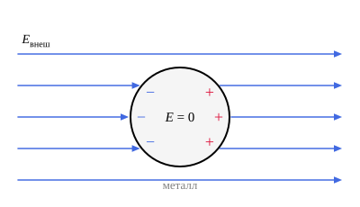

В уроке 3.1 мы узнали, что в металле есть свободные электроны. Внесём кусок металла в электрическое поле — например, между заряженными пластинами, где поле однородное (урок 2.4). На каждый свободный электрон поле действует силой. Что будет дальше?

## Электроны сдвигаются

Сила, действующая на отрицательный заряд, направлена **против** поля (урок 2.2). Поэтому свободные электроны сдвигаются против поля и скапливаются на одной стороне металла — она заряжается отрицательно. На другой стороне электронов теперь не хватает, и там остаются некомпенсированные положительные ионы. Металл в целом по-прежнему не заряжен, но его стороны заряжены разноимённо.

Появление зарядов на проводнике под действием внешнего поля называют **электростатической индукцией**, а сами заряды — **индуцированными**.

## Почему электроны останавливаются

Индуцированные заряды создают своё поле. Внутри металла оно направлено от плюса к минусу, то есть **против** внешнего поля. Чем больше электронов сдвинулось, тем сильнее это встречное поле и тем слабее суммарное поле внутри.

Электроны движутся, пока на них действует сила, то есть пока внутри есть поле. Поэтому они останавливаются ровно тогда, когда поле индуцированных зарядов полностью погасит внешнее. Это происходит почти мгновенно — за доли наносекунды.

> Внутри проводника, в котором заряды не движутся, напряжённость электрического поля равна нулю: ${E = 0}$.

На рисунке видно, как это выглядит. Линии внешнего поля заканчиваются на отрицательных индуцированных зарядах с одной стороны шара и снова начинаются от положительных с другой. Внутрь металла не заходит ни одна линия.

<pp-task id="ks-cond-01"></pp-task>

## Модель: металл в поле

Между двумя пластинами — металлическая пластинка. Точки в ней — свободные электроны. Включи поле и посмотри, как электроны сдвигаются против поля, как на сторонах пластинки появляются индуцированные заряды и как исчезают линии поля внутри. Электроны в модели сдвигаются заметно, а на самом деле — на ничтожное расстояние: чтобы погасить поле, хватает тонкого слоя зарядов у поверхности.

<pp-slab material="metal">Модель: металлическая пластинка между двумя заряженными пластинами. Когда поле включают, свободные электроны сдвигаются против поля, на сторонах пластинки появляются индуцированные заряды, и поле внутри неё исчезает.</pp-slab>

Попробуй:

- включи поле и найди, на каких зарядах заканчиваются линии;
- выключи поле — куда возвращаются электроны и остаётся ли пластинка заряженной?

<pp-task id="ks-cond-07"></pp-task>

## Заряд — на поверхности

Из ${E = 0}$ внутри следуют ещё два важных свойства проводника.

**Весь заряд проводника — на его поверхности.** Если бы где-то внутри металла остался лишний заряд, от него расходились бы линии поля — а поля внутри нет. Поэтому, если зарядить металлический шар, лишние электроны (или их нехватка) окажутся в тонком слое у поверхности. Это относится и к индуцированным зарядам, и к заряду, который сообщили проводнику.

**Линии поля подходят к поверхности под прямым углом.** Если бы поле у поверхности было направлено наискосок, у него была бы составляющая вдоль поверхности, и электроны поехали бы вдоль неё. Раз заряды не движутся, такой составляющей нет. Посмотри на рисунок: линии изгибаются, чтобы войти в шар перпендикулярно его поверхности.

Проверь себя: металлический шар, не заряженный в целом, поместили в поле. Какой у него суммарный заряд?

Ноль. Электроны только перераспределились внутри шара: сколько минуса появилось с одной стороны, столько плюса — с другой. Закон сохранения заряда (урок 1.3).

## Частые ловушки

- **«Внутри металла поле ослабевает, но не до нуля».** Электроны движутся, пока поле есть, поэтому в равновесии внутри проводника ${E = 0}$ точно.
- **«Индуцированный заряд — это заряд, пришедший извне».** Нет: это электроны самого проводника, которые сдвинулись. Суммарный заряд проводника не изменился.
- **«Заряд металлического шара распределён по всему объёму».** Только по поверхности.

## Коротко

- В поле свободные электроны проводника смещаются против поля — это электростатическая индукция.
- Поле индуцированных зарядов гасит внешнее: внутри проводника ${E = 0}$.
- Заряд проводника — на поверхности; линии поля перпендикулярны поверхности.

Дальше — урок 3.3: какое поле создаёт вокруг себя заряженный металлический шар.
