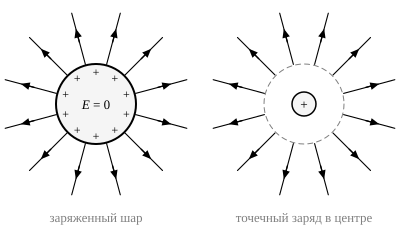
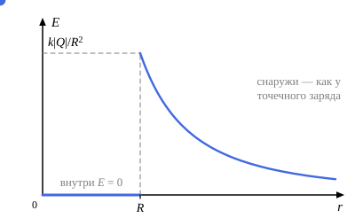

В задачах ЕГЭ проводник почти всегда — металлический шар. Его поле считается по формуле, которую ты уже знаешь, если правильно выбрать расстояние.

## Заряд на поверхности, поле — как у точки

Сообщим металлическому шару заряд $Q$. По уроку 3.2 весь заряд уйдёт на поверхность. А раз шар симметричный, ни одно место поверхности не лучше другого — заряд распределится по ней **равномерно**.

Такой шар снаружи создаёт поле, в точности как **точечный заряд $Q$, помещённый в центр шара**. Линии поля расходятся от поверхности по радиусам — так же, как от точечного заряда. Доказательство требует математики за пределами школы, поэтому примем это как факт. Он знаком по механике: планета притягивает тело так, будто вся её масса собрана в центре, и в законе тяготения берут расстояние до центра (урок 7.1 из механики).

Поэтому для точек снаружи шара поле считают по формуле урока 2.3:

$$
E = k\,\frac{|Q|}{r^2}, \qquad r \ge R,
$$

где $r$ — расстояние **от центра** шара до точки, а $R$ — радиус шара. Самое сильное поле — у самой поверхности, где ${r = R}$:

$$
E = k\,\frac{|Q|}{R^2}.
$$

А **внутри** шара, при ${r < R}$, поле равно нулю — это проводник (урок 3.2).

**Пример.** Металлический шар радиусом $5\ \text{см}$ несёт заряд $5\ \text{нКл}$. У его поверхности

$$
E = 9 \cdot 10^9 \cdot \frac{5 \cdot 10^{-9}}{0{,}05^2} = \frac{45}{0{,}0025},
$$

$$
E = 18\ 000\ \text{В/м} = 18\ \text{кВ/м}.
$$

В любой точке внутри шара — ноль.

<pp-task id="ks-cond-02"></pp-task>

## График E(r)

Соберём всё вместе. Пока точка внутри шара, поля нет. На поверхности поле скачком становится максимальным, а дальше убывает как $1/r^2$ — так же, как у точечного заряда.

Такой же график получится и у **полого** металлического шара — у металлической сферы с пустотой внутри. Заряд и так сидит только на поверхности, поэтому неважно, есть ли под ней металл. Снаружи поле то же, внутри — снова ноль.

<pp-task id="ks-cond-08"></pp-task>

Проверь себя: заряд металлического шара увеличили втрое, а радиус оставили прежним. Как изменилось поле внутри шара и у его поверхности?

Внутри как было ноль, так и осталось. У поверхности поле выросло втрое: ${E = k|Q|/R^2}$ пропорционально заряду.

## Частые ловушки

- **Считают поле внутри шара по формуле точечного заряда.** Формула верна только снаружи, при ${r \ge R}$. Внутри металлического шара ${E = 0}$.
- **Думают, что у полого шара поле меньше, чем у сплошного.** Заряд в обоих случаях на поверхности — поле одинаковое.

## Коротко

- Заряд металлического шара — на поверхности, равномерно.
- Снаружи ${E = k|Q|/r^2}$, $r$ — от центра; у поверхности ${E = k|Q|/R^2}$.
- Внутри шара — сплошного или полого — ${E = 0}$.

Дальше — урок 3.4: каков потенциал заряженного проводника.
