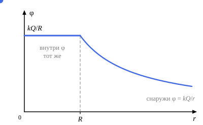

Внутри проводника ${E = 0}$ (урок 3.2). Значит ли это, что и потенциал внутри равен нулю? Нет — и в этом уроке разберёмся, чему он равен.

## Весь проводник — один потенциал

Перенесём пробный заряд из одной точки проводника в другую — по металлу или по его поверхности. Поля внутри нет, сила на заряд не действует, и работа поля равна нулю. Но работа поля — это ${A = qU}$ (урок 2.5). Раз ${A = 0}$, то и напряжение между любыми двумя точками проводника ${U = 0}$: их потенциалы одинаковы.

> Все точки проводника, в котором заряды не движутся, имеют **один и тот же потенциал**. Его поверхность — эквипотенциальная поверхность.

Это согласуется с уроком 3.2. Линии поля перпендикулярны эквипотенциальным поверхностям (урок 2.6) — и мы видели, что у поверхности проводника они подходят к ней под прямым углом.

Поэтому говорят просто «потенциал проводника», не уточняя, в какой точке: он везде одинаковый.

## Потенциал шара

Снаружи металлический шар создаёт такое же поле, как точечный заряд в центре (урок 3.3). Значит, и потенциал снаружи такой же, как у точечного заряда (урок 2.7):

$$
\varphi = k\,\frac{Q}{r}, \qquad r \ge R.
$$

На поверхности ${r = R}$, и потенциал шара

$$
\varphi = k\,\frac{Q}{R}.
$$

Внутри шара потенциал такой же, как на поверхности: весь шар — один потенциал. Поля внутри нет, а потенциал есть, и он не ноль.

Сравни с графиком $E(r)$ из урока 3.3: напряжённость внутри ноль и скачком растёт на поверхности, а потенциал внутри постоянный, без скачка переходит в $kQ/r$ и плавно убывает. Где потенциал не меняется, там нет поля, — как в уроке 2.6, где ${U = Ed}$: нет $E$ — нет и разности потенциалов.

**Пример.** Шар из урока 3.3 — радиус $5\ \text{см}$, заряд $5\ \text{нКл}$. Его потенциал

$$
\varphi = 9 \cdot 10^9 \cdot \frac{5 \cdot 10^{-9}}{0{,}05} = \frac{45}{0{,}05} = 900\ \text{В}.
$$

Заметь: поле у его поверхности было $18\ 000\ \text{В/м}$, и ${18\ 000 \cdot 0{,}05 = 900}$. Так для шара всегда: у поверхности ${\varphi = ER}$, ведь ${kQ/R = (kQ/R^2) \cdot R}$.

<pp-task id="ks-cond-03"></pp-task>

Проверь себя: можно ли найти внутри куска металла две точки, между которыми есть напряжение?

Нет, пока заряды в металле не движутся. Поля внутри нет, работа поля при переносе заряда между любыми точками равна нулю, значит, и напряжение ${U = A/q = 0}$.

<pp-task id="ks-cond-09"></pp-task>

## Частые ловушки

- **«Внутри проводника $E = 0$, значит, и $\varphi = 0$».** Ноль — напряжённость. Потенциал внутри такой же, как на поверхности.
- **Возводят радиус в квадрат.** У потенциала ${\varphi = kQ/R}$ — радиус в первой степени; квадрат — у напряжённости.
- **Теряют знак.** У отрицательно заряженного шара потенциал отрицательный.

## Коротко

- Весь проводник имеет один потенциал; его поверхность — эквипотенциальная.
- Шар: снаружи ${\varphi = kQ/r}$, на поверхности и внутри ${\varphi = kQ/R}$.
- У поверхности шара ${\varphi = ER}$.

Дальше — урок 3.5: что будет, если соединить проволокой два заряженных шара.
