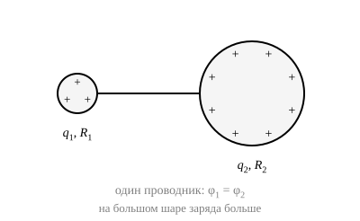

В уроке 1.3 одинаковые шарики после касания делили заряд поровну, а про разные мы сказали только, что большой забирает больше. Теперь можно сказать, сколько именно.

## Заряд течёт, пока потенциалы разные

Возьмём два металлических шара, далеко друг от друга, и соединим их тонкой проволокой. Шары и проволока вместе — это **один проводник**. А у проводника, в котором заряды не движутся, потенциал везде одинаковый (урок 3.4).

Если сразу после соединения потенциалы шаров разные, между ними есть напряжение, и по проволоке побегут электроны — от меньшего потенциала к большему (урок 2.5). Они бегут, пока потенциалы не сравняются. Это происходит почти мгновенно.

Шары далеко друг от друга, поэтому потенциал каждого создаёт в основном его собственный заряд: ${\varphi = kq/R}$. Условие равновесия:

$$
k\,\frac{q_1}{R_1} = k\,\frac{q_2}{R_2}
\quad\Rightarrow\quad
\frac{q_1}{R_1} = \frac{q_2}{R_2}.
$$

Заряды **пропорциональны радиусам**: шар вдвое больше — заряда вдвое больше. А сумма зарядов не меняется (урок 1.3):

$$
q_1 + q_2 = q_{1,0} + q_{2,0}.
$$

Двух уравнений хватает, чтобы найти оба заряда. Для одинаковых шаров ${R_1 = R_2}$, и получается знакомое «поровну».

**Пример.** Шары радиусами $3\ \text{см}$ и $5\ \text{см}$ вместе несут $24\ \text{нКл}$. После соединения заряды относятся как ${3 : 5}$: всего восемь частей по $3\ \text{нКл}$. На маленьком шаре ${3 \cdot 3 = 9\ \text{нКл}}$, на большом ${5 \cdot 3 = 15\ \text{нКл}}$. Неважно, как заряд был распределён до соединения: результат зависит только от суммы.

<pp-task id="ks-cond-04"></pp-task>

Проверь себя: шар радиусом 5 см с зарядом 22 нКл соединили проволокой с таким же незаряженным шаром. Какой заряд у каждого?

По ${11\ \text{нКл}}$. Шары одинаковые, их потенциалы равны, когда равны заряды, — как в уроке 1.3.

<pp-task id="ks-cond-10"></pp-task>

## Где поле сильнее

У маленького шара заряда меньше, но поле у его поверхности сильнее. Поле у поверхности ${E = kq/R^2 = \varphi/R}$ (урок 3.4), а потенциал у шаров одинаковый. Значит, чем меньше радиус, тем сильнее поле.

То же у проводника сложной формы: на остриях, где поверхность сильно изогнута, как у очень маленького шара, поле самое сильное. Около острия поле может стать таким сильным, что воздух начинает проводить и заряд стекает с острия. На этом основан **молниеотвод**: металлический стержень с острым концом над крышей, соединённый с землёй.

## Частые ловушки

- **Делят заряд поровну между разными шарами.** Поровну — только для одинаковых. Для разных — пропорционально радиусам.
- **Переворачивают пропорцию.** На большом шаре заряда больше, а не меньше.
- **Забывают, что сумма зарядов сохраняется.** Второе уравнение — закон сохранения заряда.

## Коротко

- Соединённые проводники — один проводник с одним потенциалом.
- Далёкие шары: ${q_1/R_1 = q_2/R_2}$ и ${q_1 + q_2 = \text{const}}$.
- У маленького шара и у острия поле у поверхности сильнее.

Дальше — урок 3.6: как металл защищает от поля и как зарядить тело, не касаясь его.
