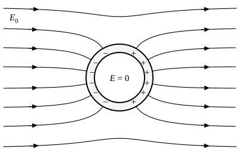

Индукция — не только причина того, что внутри металла нет поля. Она защищает приборы и людей от электрических полей и позволяет заряжать тела, не прикасаясь к ним.

## Полость в металле

В уроке 3.3 мы выяснили, что полый металлический шар создаёт такое же поле, как сплошной, а внутри у него ноль. Это верно и для внешнего поля. Поместим полую металлическую оболочку в поле: индуцированные заряды соберутся на **внешней** поверхности и погасят поле и в металле, и в пустоте внутри.

Металлическая оболочка **экранирует** внешнее электрическое поле: что бы ни происходило снаружи, внутри поля нет. Это **электростатическая защита**. Оболочка не обязательно сплошная — хватает частой металлической сетки. Такую сетчатую клетку называют клеткой Фарадея.

Примеры вокруг нас:

- чувствительные приборы закрывают металлическими корпусами, а провода антенн и микрофонов — металлической оплёткой;
- в металлической кабине лифта плохо ловит мобильная связь: кабина работает как клетка Фарадея для радиоволн;
- в автомобиле во время грозы безопасно: при ударе молнии ток идёт по металлическому кузову снаружи, не заходя в салон.

## Электризация через влияние

Поднесём к незаряженному металлическому шару, не касаясь, отрицательно заряженную эбонитовую палочку. Свободные электроны шара отталкиваются от неё и уходят на дальнюю сторону; ближняя сторона заряжается положительно. Шар в целом не заряжен — это индукция из урока 3.2.

Теперь, не убирая палочку, коснёмся шара пальцем. Тело человека и земля — проводники (урок 3.1), и вместе с шаром они становятся одним огромным проводником. Электроны, которых палочка отталкивает, уходят по руке в землю. Уберём палец, а потом палочку. Ушедшие электроны уже не вернутся, и шар останется заряженным **положительно** — знак противоположен знаку палочки.

Это **электризация через влияние**. Палочка при этом не теряет ни капли своего заряда: она только «выгоняет» электроны. Её можно использовать снова и снова.

Порядок важен. Если сначала убрать палочку, а потом руку, электроны вернутся из земли, и шар останется незаряженным.

Есть и другой способ, без заземления: взять два соприкасающихся шара, поднести палочку и раздвинуть шары, пока палочка рядом. Тогда заряды разного знака окажутся на разных шарах.

<pp-task id="ks-cond-11"></pp-task>

Проверь себя: чем отличается заряд шара, если коснуться его заряженной палочкой, от заряда, полученного через влияние?

При касании часть заряда палочки переходит на шар, и шар заряжается так же, как палочка. Через влияние с заземлением шар получает заряд противоположного знака, а палочка свой заряд не теряет.

## Частые ловушки

- **Путают электризацию касанием и через влияние.** При касании знак тот же, через влияние — противоположный.
- **Убирают тело раньше заземления.** Тогда электроны возвращаются, и заряда не остаётся.
- **«Внутри металлической коробки поле есть, только слабое».** Если коробка замкнута (или это частая сетка), внутри ${E = 0}$.

## Коротко

- В полости внутри проводника ${E = 0}$: металлическая оболочка экранирует внешнее поле.
- Электризация через влияние: поднести заряд, заземлить, убрать заземление, убрать заряд.
- Через влияние тело заряжается противоположно заряду, который подносили.

Дальше — урок 3.7: как ведёт себя в поле диэлектрик.
