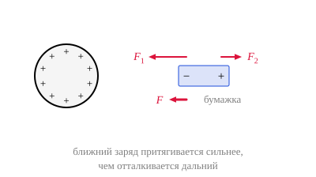

В уроке 1.5 мы узнали, что в керосине заряды взаимодействуют вдвое слабее, чем в воздухе, а в воде — в $81$ раз, и обещали объяснить почему. В уроке 1.1 бумажки притягивались к расчёске, хотя они не заряжены. Обе загадки решает одно явление — поляризация диэлектрика.

## Молекулы поворачиваются

В диэлектрике свободных электронов нет (урок 3.1), и далеко уйти заряды не могут. Но в пределах своей молекулы они смещаются:

- у некоторых молекул, например у воды, положительный и отрицательный заряды и без поля сидят в разных концах — такая молекула похожа на маленькую палочку с плюсом на одном конце и минусом на другом. В поле её плюс тянет вдоль поля, а минус — против, и молекула **поворачивается** вдоль поля;
- у других молекул заряды без поля «наложены» друг на друга, но в поле электронное облако немного сдвигается против поля, и молекула **вытягивается** в такую же палочку.

Так или иначе молекулы выстраиваются плюсом вдоль поля. Это **поляризация** диэлектрика.

Внутри диэлектрика плюс одной молекулы соседствует с минусом следующей, и их заряды в среднем гасят друг друга. А у поверхностей остаются нескомпенсированные концы молекул: у одной поверхности минусы, у другой плюсы. Это **связанные заряды** — уйти со своих молекул они не могут.

## Поле ослабевает в ε раз

Связанные заряды, как индуцированные заряды в металле, создают поле **против** внешнего. Но погасить его полностью они не могут: молекулы поворачиваются лишь частично, а заряды не покидают своих молекул. Поле внутри диэлектрика ослабевает, но не до нуля. Во сколько раз — показывает **диэлектрическая проницаемость** вещества:

$$
E = \frac{E_0}{\varepsilon}.
$$

Здесь $E_0$ — поле, которое было бы в вакууме, а $E$ — поле в диэлектрике. На рисунке половина линий заканчивается на связанных зарядах — внутри поле вдвое слабее, как в керосине.

| Вещество | $\varepsilon$ |
|---|---|
| вакуум, воздух | $1$ |
| керосин, парафин | около $2$ |
| эбонит | около $3$ |
| стекло | около $7$ |
| вода | $81$ |

У воды ${\varepsilon}$ такая большая потому, что её молекулы и без поля полярные и легко поворачиваются.

## Модель: диэлектрик в поле

Та же модель, что в уроке 3.2, но пластинку теперь можно сделать из диэлектрика. Включи поле и посмотри, как поворачиваются молекулы и сколько линий поля проходит внутрь. Сравни с металлом.

<pp-slab material="kerosene" dielectrics>Модель: пластинка из металла или диэлектрика (керосин, эбонит, вода) между двумя заряженными пластинами. Когда поле включают, молекулы диэлектрика поворачиваются вдоль поля, на его поверхностях появляются связанные заряды, и поле внутри ослабевает в ε раз; в металле оно исчезает совсем.</pp-slab>

Попробуй:

- сравни, сколько линий проходит сквозь керосин и сквозь эбонит;
- выбери воду: чем она похожа на металл и чем отличается?

<pp-task id="ks-cond-12"></pp-task>

## Почему сила Кулона меньше в ε раз

Поле точечного заряда в диэлектрике тоже в $\varepsilon$ раз слабее:

$$
E = k\,\frac{|Q|}{\varepsilon r^2}.
$$

Второй заряд, помещённый в это поле, испытывает силу ${F = |q|E}$ (урок 2.2) — тоже в $\varepsilon$ раз меньшую, чем в вакууме. Это и есть закон Кулона в диэлектрике из урока 1.5. Среда ослабляет взаимодействие, потому что её связанные заряды окружают каждый заряд «шубой» противоположного знака.

**Пример.** Заряд $5\ \text{нКл}$ на расстоянии $10\ \text{см}$ создаёт в воздухе поле

$$
E_0 = 9 \cdot 10^9 \cdot \frac{5 \cdot 10^{-9}}{0{,}1^2} = 4500\ \text{В/м}.
$$

В воде поле того же заряда в $81$ раз слабее:

$$
E = \frac{4500}{81} \approx 56\ \text{В/м}.
$$

<pp-task id="ks-cond-05"></pp-task>

## Почему бумажка притягивается к расчёске

Теперь вернёмся к бумажкам из урока 1.1. Бумага — диэлектрик. В поле заряженной расчёски она поляризуется: на ближней к расчёске стороне оказываются связанные заряды противоположного знака, на дальней — того же.

Ближний заряд притягивается, дальний отталкивается. Если бы поле было однородным, эти силы были бы равны и бумажка стояла бы на месте. Но поле расчёски сильнее вблизи неё ($E \sim 1/r^2$), поэтому притяжение ближнего заряда **больше** отталкивания дальнего. Итог — бумажка притягивается. Неважно, какой знак у расчёски: ближе к ней всегда окажется противоположный заряд.

Так же притягиваются к заряженным телам и незаряженные проводники — кусочки фольги, металлическая гильза, — только у них работает индукция (урок 3.2), а не поляризация. Поэтому притяжение и не доказывает, что второе тело заряжено, — как мы и говорили в уроке 1.1.

Проверь себя: незаряженную бумажку поместили в однородное поле между пластинами. Будет ли она двигаться к одной из пластин?

Нет. Бумажка поляризуется, но в однородном поле силы, действующие на её плюс и минус, равны и противоположны. Сумма сил — ноль. Притягиваются незаряженные тела только в неоднородном поле.

## Частые ловушки

- **Умножают на $\varepsilon$.** Диэлектрик ослабляет поле: $\varepsilon$ стоит в знаменателе.
- **«Внутри диэлектрика, как в металле, поля нет».** Поле ослабевает в $\varepsilon$ раз, но не исчезает.
- **«Незаряженное тело не притягивается к заряженному».** Притягивается — из-за поляризации или индукции.

## Коротко

- В поле молекулы диэлектрика поляризуются, на его поверхностях появляются связанные заряды.
- Поле в диэлектрике ${E = E_0/\varepsilon}$; поле точечного заряда и сила Кулона тоже в $\varepsilon$ раз меньше.
- Незаряженные тела притягиваются к заряженным: ближний заряд противоположного знака в более сильном поле.

Это последний урок темы. Дальше — тема «Конденсаторы»: два проводника, разделённые диэлектриком, которые накапливают заряд.
