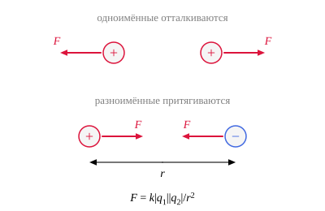

Сними свитер в темноте — услышишь треск и увидишь искорки. Потри воздушный шарик о волосы — он прилипнет к стене. Это электризация. С неё начинается электродинамика, а закон Кулона встречается в задаче 11 и в задачах 14–15.

Электризацию, два рода зарядов и электрон проходят в 8 классе. Закон сохранения заряда и закон Кулона — в 10. Пригодятся законы Ньютона: сила Кулона — такая же сила, как остальные, и подчиняется третьему закону.

## Шаг 1. Электризация и два рода зарядов (8 класс)

Потри стеклянную палочку о шёлк, а эбонитовую — о мех. Обе начнут притягивать бумажки, а друг к другу — притягиваться. Две стеклянные палочки отталкиваются. Значит, зарядов два вида: **положительные** и **отрицательные**. Одноимённые отталкиваются, разноимённые притягиваются.

**Электрический заряд** $q$ — величина, которая показывает, насколько сильно тело участвует в электрических взаимодействиях. Единица — кулон (Кл).

При электризации трением заряжаются **оба** тела, и заряды у них разных знаков.

## Шаг 2. Электрон и элементарный заряд (8 класс)

Заряд нельзя делить бесконечно: он всегда кратен **элементарному заряду**

$$
e = 1{,}6 \cdot 10^{-19}\ \text{Кл}.
$$

Электрон несёт заряд $-e$, протон $+e$. Тело заряжено отрицательно, если в нём электронов больше, чем протонов, и положительно — если меньше. При электризации трением с одного тела на другое переходят именно электроны.

Если у тела $N$ лишних электронов, его заряд $q = -Ne$; если $N$ электронов не хватает, $q = +Ne$.

<pp-task id="ks-coul-01"></pp-task>

## Шаг 3. Закон сохранения заряда (10 класс)

Когда ты трёшь шарик о волосы, часть электронов переходит с волос на шарик. Шарик заряжается отрицательно, волосы — положительно. Заряды не появились из ниоткуда: они перераспределились.

Это **закон сохранения заряда**: в замкнутой системе алгебраическая сумма зарядов постоянна:

$$
q_1 + q_2 + \dots = \text{const}.
$$

Полезное следствие. Два **одинаковых** металлических шарика с зарядами $q_1$ и $q_2$ привели в соприкосновение и развели. Заряд поделился поровну:

$$
q_1' = q_2' = \frac{q_1 + q_2}{2}.
$$

Знаки учитываются: $+6$ и $-2$ мкКл дадут по $+2$ мкКл.

<pp-task id="ks-coul-02"></pp-task>

## Шаг 4. Закон Кулона (10 класс)

Два точечных заряда действуют друг на друга с силой

$$
F = k\,\frac{|q_1|\,|q_2|}{r^2}.
$$

- $q_1$, $q_2$ — заряды, Кл;
- $r$ — расстояние между ними, м;
- $k = 9 \cdot 10^9\ \text{Н} \cdot \text{м}^2/\text{Кл}^2$.

Сила направлена вдоль прямой, соединяющей заряды. По третьему закону Ньютона заряды действуют друг на друга с равными по модулю силами — даже если сами заряды разные.

Закон верен для **точечных** зарядов (размеры тел малы по сравнению с расстоянием) и для заряженных шаров (тогда $r$ — между центрами).

<pp-task id="ks-coul-03"></pp-task>

## Шаг 5. Сила и расстояние (10 класс)

Как и в законе всемирного тяготения, сила обратно пропорциональна **квадрату** расстояния. Расстояние выросло вдвое — сила уменьшилась вчетверо. Втрое — в девять раз.

А от зарядов сила зависит линейно: один из зарядов увеличили вдвое — сила выросла вдвое.

<pp-task id="ks-coul-04"></pp-task>

## Шаг 6. Заряды в диэлектрике (10 класс)

В диэлектрике (например, в масле или воде) сила взаимодействия уменьшается в $\varepsilon$ раз, где $\varepsilon$ — диэлектрическая проницаемость среды:

$$
F = k\,\frac{|q_1|\,|q_2|}{\varepsilon r^2}.
$$

У воздуха $\varepsilon \approx 1$, у керосина около $2$, у воды около $81$. Почему среда ослабляет взаимодействие, разберём в теме «Проводники и диэлектрики».

<pp-task id="ks-coul-05"></pp-task>

## Шаг 7. Несколько зарядов (10 класс)

Если на заряд действуют несколько других, силы считают по отдельности и складывают **как векторы** (принцип суперпозиции). Для зарядов на одной прямой это сложение проекций со знаками: для каждой силы сначала определи, куда она направлена — к заряду-источнику или от него.

<pp-task id="ks-coul-06"></pp-task>

## Частые ловушки

- **Забывают возвести расстояние в квадрат.** Расстояние вдвое больше — сила вчетверо меньше.
- **Не переводят приставки.** $1\ \text{мкКл} = 10^{-6}\ \text{Кл}$, $1\ \text{нКл} = 10^{-9}\ \text{Кл}$, $1\ \text{см} = 10^{-2}\ \text{м}$.
- **Делят заряд поровну между разными шариками.** Поровну — только для одинаковых.
- **Думают, что больший заряд действует сильнее**, чем на него действуют. Силы равны по третьему закону.

## Как это выглядит на ЕГЭ

*Два одинаковых маленьких металлических шарика с зарядами $+5\ \text{нКл}$ и $-1\ \text{нКл}$ привели в соприкосновение и развели на расстояние $3\ \text{см}$. С какой силой они взаимодействуют?*

После соприкосновения заряды поровну:

$$
q = \frac{5 + (-1)}{2} = 2\ \text{нКл}.
$$

Оба заряда положительны — шарики отталкиваются. Сила:

$$
F = 9 \cdot 10^9 \cdot \frac{(2 \cdot 10^{-9})^2}{(0{,}03)^2} = 4 \cdot 10^{-5}\ \text{Н}.
$$

## Коротко

- Два рода зарядов; одноимённые отталкиваются, разноимённые притягиваются.
- Заряд дискретен, $e = 1{,}6 \cdot 10^{-19}\ \text{Кл}$; сумма зарядов замкнутой системы постоянна.
- Одинаковые шарики после касания: $(q_1 + q_2)/2$ каждому.
- $F = k|q_1||q_2|/(\varepsilon r^2)$, $k = 9 \cdot 10^9$.
- Силы от нескольких зарядов складываются как векторы.
