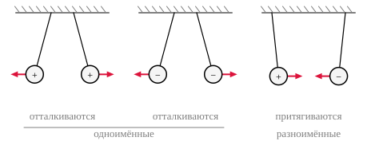
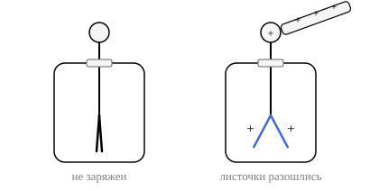

Потри пластмассовую расчёску о волосы и поднеси к мелким кусочкам бумаги. Бумажки подпрыгнут и прилипнут к расчёске. Потри воздушный шарик о свитер — он прилипнет к стене. До того как их потёрли, ни расчёска, ни шарик ничего не притягивали. Что изменилось?

## Электризация

Тело, которое после трения начало притягивать другие тела, называют **наэлектризованным** или **заряженным**. Сам процесс — **электризация**. Тело можно наэлектризовать трением, а можно касанием: если заряженной палочкой коснуться металлического шарика, шарик тоже станет заряженным.

Говорят, что заряженное тело несёт **электрический заряд** $q$. Заряд показывает, насколько сильно тело участвует в электрических взаимодействиях. Его единица — **кулон** (Кл). Кулон — огромный заряд: при электризации трением тела получают миллиардные доли кулона, поэтому в задачах заряды дают в нанокулонах и микрокулонах: ${1\ \text{нКл} = 10^{-9}\ \text{Кл}}$, ${1\ \text{мкКл} = 10^{-6}\ \text{Кл}}$.

## Два рода зарядов

Потрём стеклянную палочку о шёлк, а эбонитовую — о мех. Подвесим на нитках лёгкие шарики и коснёмся одного стеклом, другого тоже стеклом. Шарики разойдутся. Если обоих коснуться эбонитом — тоже разойдутся. А шарик, заряженный от стекла, и шарик, заряженный от эбонита, потянутся друг к другу.

Значит, зарядов **два рода**. Их договорились называть так:

- **положительный** заряд ($+$) — как у стекла, потёртого о шёлк;
- **отрицательный** заряд ($-$) — как у эбонита, потёртого о мех.

Главное правило: **одноимённые заряды отталкиваются, разноимённые — притягиваются.**

Обрати внимание: на рисунке силы на двух шариках каждой пары одинаковы и направлены в разные стороны. Это третий закон Ньютона (урок 5.5 из механики): шарики действуют друг на друга, как любые два тела. Электрическая сила — обычная сила, и всё, что мы знаем о силах, к ней применимо.

Проверь себя: заряженный шарик отталкивается от палочки, потёртой о мех. Какой у него знак заряда?

Отрицательный. Эбонит, потёртый о мех, заряжен отрицательно, а отталкиваются одноимённые заряды.

<pp-task id="ks-coul-07"></pp-task>

## Заряжаются оба тела

Когда трут стекло о шёлк, заряжается не только стекло, но и шёлк. Шёлк притянет к себе стеклянную палочку — значит, его заряд противоположного знака, отрицательный. Так всегда: **при электризации трением заряжаются оба тела, и заряды у них разных знаков.** Почему так получается, разберём в следующем уроке.

Притяжение бумажек к расчёске — особый случай: бумажки не заряжены, а притягиваются. Заряженное тело притягивает и незаряженные лёгкие тела. Поэтому по притяжению нельзя сказать наверняка, заряжено ли второе тело. А вот отталкивание — верный признак: отталкиваться могут только два заряженных тела с одинаковыми знаками.

## Электроскоп

Как узнать, заряжено ли тело? Для этого есть прибор — **электроскоп**. Это металлический стержень с шариком наверху, а внизу на стержне подвешены два лёгких листочка. Стержень вставлен в корпус через изолирующую пробку, чтобы заряд не уходил на корпус.

Коснёмся шарика заряженной палочкой. Часть заряда перейдёт на шарик, стержень и листочки. Оба листочка получат заряды одного знака — и разойдутся. Чем больше заряд, тем сильнее они расходятся. Электроскоп показывает, есть ли заряд и велик ли он, но не его знак.

## Частые ловушки

- **«Притягивается — значит, заряжено».** Заряженное тело притягивает и незаряженные лёгкие тела. Надёжный признак заряда — отталкивание.
- **«Заряжается только то тело, которое трут».** Заряжаются оба, и заряды у них противоположные.
- **Путают правило.** Одноимённые (одного знака) отталкиваются, разноимённые притягиваются.

## Коротко

- Тела заряжаются при трении и при касании заряженным телом.
- Зарядов два рода: положительные и отрицательные. Одноимённые отталкиваются, разноимённые притягиваются.
- При трении заряжаются оба тела, разными знаками.
- Заряд $q$ измеряют в кулонах; кулон — очень большой заряд.
- Электроскоп показывает, заряжено ли тело: его листочки расходятся.

Дальше — урок 1.2: что такое заряд на самом деле и что переходит с одного тела на другое при трении.
