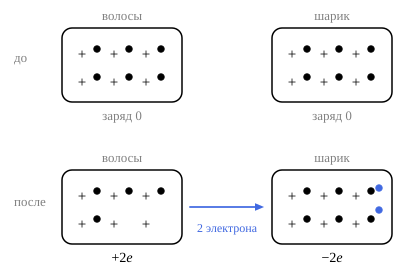

В прошлом уроке при трении заряжались оба тела, и всегда разными знаками. Почему именно так? Заряд не может появиться у одного тела сам по себе — значит, что-то переходит с одного тела на другое. Чтобы понять, что именно, заглянем внутрь вещества.

## Из чего состоит атом

Вещество состоит из молекул, а молекулы — из атомов (урок 1.1 из МКТ). Атом тоже не неделим. В его центре — крошечное **ядро**, заряженное положительно. Вокруг ядра движутся **электроны** — очень лёгкие частицы с отрицательным зарядом.

Положительный заряд ядра несут **протоны**. Заряд протона и заряд электрона равны по модулю и противоположны по знаку. В обычном атоме протонов и электронов поровну, поэтому атом в целом **нейтрален**: его заряд равен нулю. Нейтрально и тело, составленное из таких атомов, хотя внутри него огромное число зарядов обоих знаков.

Кстати, силы, с которыми притягиваются и отталкиваются молекулы (урок 1.3 из МКТ), — электрические: это притяжение и отталкивание ядер и электронов соседних молекул.

## Как тело заряжается

Ядра сидят в атомах прочно, а электроны, особенно внешние, можно оторвать. Когда трут шарик о волосы, часть электронов с волос переходит на шарик.

- На шарике электронов стало **больше**, чем протонов, — он заряжен **отрицательно**.
- На волосах электронов стало **меньше** — их заряд **положительный**.

Вот почему при трении заряжаются оба тела, и разными знаками: сколько электронов ушло с одного тела, столько пришло на другое. Положительный заряд не «переходит» — он остаётся там, где электронов не хватает.

## Элементарный заряд

Заряд электрона — самый маленький заряд, который встречается у свободных частиц. Его называют **элементарным зарядом**:

$$
e = 1{,}6 \cdot 10^{-19}\ \text{Кл}.
$$

Электрон несёт заряд $-e$, протон $+e$. Тело может получить или потерять только целое число электронов, поэтому любой заряд кратен $e$. Если у тела $N$ лишних электронов, его заряд ${q = -Ne}$. Если $N$ электронов не хватает, ${q = +Ne}$.

**Пример.** Металлический шарик потерял миллиард электронов, ${N = 10^9}$. Его заряд положительный:

$$
q = +Ne = 10^9 \cdot 1{,}6 \cdot 10^{-19} = 1{,}6 \cdot 10^{-10}\ \text{Кл}.
$$

Это $0{,}16\ \text{нКл}$ — миллиард электронов дают совсем небольшой заряд. А заряд в $1\ \text{Кл}$ — это около ${6 \cdot 10^{18}}$ электронов.

<pp-task id="ks-coul-01"></pp-task>

Обратная задача: по заряду найти число электронов. Раздели заряд на $e$: ${N = |q|/e}$. Не забудь перевести нанокулоны в кулоны.

<pp-task id="ks-coul-08"></pp-task>

Проверь себя: может ли заряд тела быть равен 0,8 · 10⁻¹⁹ Кл?

Нет. Это половина элементарного заряда, а тело не может потерять или получить полэлектрона. Любой заряд — целое число $e$.

## Частые ловушки

- **Теряют знак.** Лишние электроны — заряд отрицательный, недостающие — положительный.
- **Думают, что переходят положительные заряды.** При электризации переходят электроны; ядра остаются на месте.
- **Не переводят приставки.** $1\ \text{нКл} = 10^{-9}\ \text{Кл}$, $1\ \text{мкКл} = 10^{-6}\ \text{Кл}$.

## Коротко

- Атом: положительное ядро (протоны) и отрицательные электроны; обычно нейтрален.
- Тело заряжается, получая или теряя электроны.
- ${e = 1{,}6 \cdot 10^{-19}\ \text{Кл}}$; заряд тела ${q = \pm Ne}$: минус — лишние электроны, плюс — недостающие.

Дальше — урок 1.3: если электроны только переходят, общий заряд не меняется. Это закон сохранения заряда.
