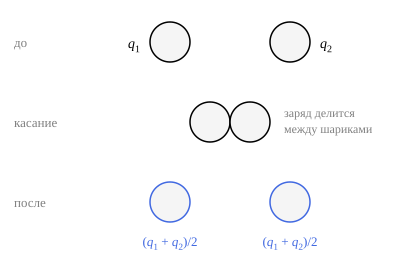

В уроке 1.2 при трении электроны переходили с волос на шарик. Волосы получили $+2e$, шарик $-2e$, а вместе — ноль, как и до трения. Это не совпадение. В этом уроке — закон, который за этим стоит, и главное его применение в задачах: шарики, которые коснулись друг друга.

## Сумма зарядов не меняется

Электроны не исчезают и не появляются из ничего — они только переходят с тела на тело. Поэтому, пока заряды не уходят из системы и не приходят в неё извне, их сумма остаётся прежней. Это **закон сохранения заряда**:

> в замкнутой системе алгебраическая сумма зарядов постоянна:
>
> $$q_1 + q_2 + \dots + q_n = \text{const}.$$

**Алгебраическая** сумма — сумма со знаками: положительные заряды складываются с отрицательными и частично их компенсируют. Заряды $+12\ \text{нКл}$ и $-12\ \text{нКл}$ в сумме дают ноль.

Это такой же закон сохранения, как закон сохранения импульса или энергии в механике: что-то может перераспределяться между телами, но в сумме не меняется.

## Одинаковые шарики после касания

Два **одинаковых** металлических шарика с зарядами $q_1$ и $q_2$ привели в соприкосновение. Электроны перебегают с одного шарика на другой, пока заряды не выровняются. Шарики одинаковые, поэтому ни у одного нет преимущества — общий заряд делится **поровну**:

$$
q_1' = q_2' = \frac{q_1 + q_2}{2}.
$$

Знаки учитываются. **Пример.** Шарики с зарядами $+29\ \text{нКл}$ и $-7\ \text{нКл}$ коснулись друг друга:

$$
q' = \frac{29 + (-7)}{2} = +11\ \text{нКл}.
$$

Если один шарик не заряжен, второй отдаёт ему половину своего заряда. Шарик с зарядом $-14\ \text{нКл}$ коснулся незаряженного такого же — у каждого стало $-7\ \text{нКл}$.

<pp-task id="ks-coul-02"></pp-task>

Проверь себя: шарики с зарядами +9 нКл и −9 нКл коснулись друг друга. Будут ли они взаимодействовать после того, как их развели?

Нет. Сумма зарядов $9 + (-9) = 0$, после касания у каждого шарика заряд $0$. Незаряженные шарики друг на друга электрически не действуют.

Если касаний несколько, иди по шагам: после каждого касания запиши новые заряды обоих шариков, а потом переходи к следующему касанию.

<pp-task id="ks-coul-09"></pp-task>

## Разные шарики

Если шарики разного размера, заряд делится **не поровну**: большой шарик забирает больше. Как именно — разберём в теме «Проводники и диэлектрики». Но закон сохранения заряда верен и здесь: сумма зарядов после касания та же, что и до него. Зная заряд одного шарика после касания, можно найти заряд другого.

<pp-task id="ks-coul-10"></pp-task>

## Частые ловушки

- **Складывают модули.** Сумма зарядов — алгебраическая: $+9$ и $-2$ в сумме дают $+7$, а не $11$.
- **Делят поровну между разными шариками.** Поровну — только для одинаковых. Для разных верна лишь сумма.
- **Забывают поделить на два.** У каждого шарика — половина общего заряда, а не весь.
- **Считают, что после касания заряд «исчез».** Если сумма зарядов не ноль, заряды после касания тоже не ноль.

## Коротко

- В замкнутой системе алгебраическая сумма зарядов постоянна.
- Одинаковые шарики после касания: ${q' = (q_1 + q_2)/2}$ каждому, со знаками.
- Разные шарики делят заряд не поровну, но сумма зарядов сохраняется.

Дальше — урок 1.4: с какой силой действуют друг на друга два заряда. Это закон Кулона.
