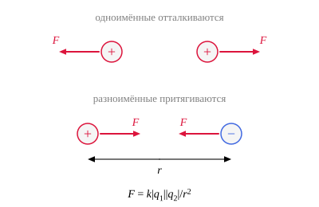

Мы знаем, что заряды притягиваются и отталкиваются. Но с какой силой? В механике похожий вопрос уже был: с какой силой притягиваются два тела? Ответом был закон всемирного тяготения (урок 7.1 из механики). Для зарядов ответ нашёл французский физик Шарль Кулон в 1785 году — и оказалось, что закон устроен почти так же.

## Формула

Два **точечных** заряда действуют друг на друга с силой

$$
F = k\,\frac{|q_1|\,|q_2|}{r^2}.
$$

- $q_1$, $q_2$ — заряды, Кл;
- $r$ — расстояние между ними, м;
- ${k = 9 \cdot 10^9\ \text{Н} \cdot \text{м}^2/\text{Кл}^2}$ — коэффициент пропорциональности. Его иногда записывают как ${k = 1/(4\pi\varepsilon_0)}$, где ${\varepsilon_0 = 8{,}85 \cdot 10^{-12}\ \text{Кл}^2/(\text{Н} \cdot \text{м}^2)}$ — электрическая постоянная.

Модули зарядов стоят в формуле потому, что она даёт модуль силы — число, которое не бывает отрицательным. Направление определяют отдельно, по знакам: одноимённые отталкиваются, разноимённые притягиваются (урок 1.1).

**Точечный** заряд — это заряженное тело, размеры которого малы по сравнению с расстоянием до других зарядов. Как материальная точка в механике (урок 1.1 из механики). Для заряженных шаров закон тоже верен, если заряд распределён по шару равномерно; тогда $r$ — расстояние **между центрами**, как в законе тяготения.

## Третий закон

Сила направлена вдоль прямой, соединяющей заряды. Заряды действуют друг на друга с **равными по модулю и противоположными** силами — это третий закон Ньютона (урок 5.5 из механики). Так даже тогда, когда заряды разные: большой заряд действует на маленький с той же силой, что и маленький на большой. В формуле $|q_1|$ и $|q_2|$ входят одинаково, и её не волнует, на какой из зарядов мы смотрим.

## Двойник закона тяготения

Сравним с законом всемирного тяготения:

$$
F = G\,\frac{m_1 m_2}{r^2} \qquad\text{и}\qquad F = k\,\frac{|q_1|\,|q_2|}{r^2}.
$$

Похоже: произведение в числителе, квадрат расстояния в знаменателе, сила вдоль прямой. Но есть два отличия.

- **Знаки.** Масса бывает только положительной, и тяготение только притягивает. Заряды двух знаков — и сила бывает и притяжением, и отталкиванием.
- **Сила.** $k$ огромно по сравнению с $G$. Электрон и протон в атоме водорода притягиваются электрически примерно в $10^{39}$ раз сильнее, чем гравитационно. Поэтому внутри атомов и молекул тяготение не играет никакой роли. А тела вокруг нас почти нейтральны: их заряды почти точно скомпенсированы, и огромные электрические силы друг друга гасят.

Чтобы почувствовать, насколько велик кулон: два заряда по $1\ \text{Кл}$ на расстоянии целого километра отталкивались бы с силой

$$
F = 9 \cdot 10^9 \cdot \frac{1 \cdot 1}{1000^2} = 9000\ \text{Н}
$$

— как вес легкового автомобиля. Такие заряды на маленьких телах не встречаются.

## Как считать

Все величины — в СИ: заряды в кулонах, расстояние в метрах.

**Пример.** Два маленьких шарика с зарядами по $7\ \text{нКл}$ находятся на расстоянии $7\ \text{см}$:

$$
F = 9 \cdot 10^9 \cdot \frac{7 \cdot 10^{-9} \cdot 7 \cdot 10^{-9}}{0{,}07^2} = 9 \cdot 10^9 \cdot 10^{-14},
$$

$$
F = 9 \cdot 10^{-5}\ \text{Н} = 90\ \text{мкН}.
$$

Удобно сократить степени до умножения: здесь ${49 \cdot 10^{-18} / (49 \cdot 10^{-4}) = 10^{-14}}$.

<pp-task id="ks-coul-03"></pp-task>

Из закона Кулона можно найти и заряд, если известна сила. Для двух одинаковых зарядов ${F = kq^2/r^2}$: выразив $q^2$, не забудь извлечь корень.

<pp-task id="ks-coul-11"></pp-task>

Проверь себя: заряд +3 нКл действует на заряд +7 нКл с силой F. С какой силой заряд +7 нКл действует на заряд +3 нКл?

С той же силой $F$, только направленной противоположно. По третьему закону силы взаимодействия равны, хоть заряды и разные.

## Частые ловушки

- **Не переводят в СИ.** Нанокулоны — в кулоны ($10^{-9}$), микрокулоны — в кулоны ($10^{-6}$), сантиметры — в метры ($10^{-2}$).
- **Забывают квадрат.** В знаменателе $r^2$, а не $r$.
- **Подставляют знаки зарядов в формулу.** Формула даёт модуль силы; знаки нужны только, чтобы понять: притяжение или отталкивание.
- **«Больший заряд действует сильнее».** Силы взаимодействия равны по третьему закону.
- **Для шаров берут расстояние между поверхностями.** Нужно — между центрами.

## Коротко

- ${F = k|q_1||q_2|/r^2}$, ${k = 9 \cdot 10^9\ \text{Н} \cdot \text{м}^2/\text{Кл}^2}$.
- Для точечных зарядов и шаров ($r$ — между центрами).
- Сила вдоль прямой через заряды; силы на двух зарядах равны и противоположны.
- Как закон тяготения, но заряды двух знаков, и сила намного больше.

Дальше — урок 1.5: как меняется сила, если изменить расстояние, заряды или поместить заряды в воду.
