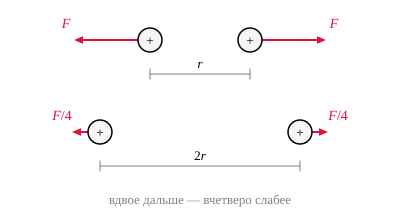

В задачах ЕГЭ закон Кулона часто спрашивают без чисел: расстояние увеличили, заряды изменили — во сколько раз изменилась сила? Считать саму силу для этого не нужно. Достаточно посмотреть, что стоит в числителе и в знаменателе формулы.

## Расстояние — в квадрате

Как и в законе тяготения (урок 7.1 из механики), сила обратно пропорциональна **квадрату** расстояния. Раздвинем заряды вдвое дальше.

Расстояние выросло в $2$ раза, $r^2$ — в $2^2 = 4$ раза, сила стала **вчетверо** меньше. Сблизим заряды — сила вырастет, и тоже «в квадрате».

**Пример.** Заряды отталкивались с силой $12\ \text{мкН}$. Расстояние между ними уменьшили вдвое. Знаменатель $r^2$ стал вчетверо меньше, сила — вчетверо больше: $48\ \text{мкН}$.

<pp-task id="ks-coul-04"></pp-task>

## Заряды — в первой степени

От каждого заряда сила зависит **линейно**. Один заряд увеличили втрое — сила выросла втрое. Оба заряда увеличили вдвое — сила выросла в $2 \cdot 2 = 4$ раза.

Если заряды и расстояние меняются вместе, посмотри отдельно, во сколько раз изменился числитель $|q_1||q_2|$ и во сколько — знаменатель $r^2$, и раздели одно на другое.

## Если шарики касались

Частый сюжет: одинаковые шарики привели в соприкосновение и развели. Заряды изменились по уроку 1.3 — и сила тоже. Сначала найди новые заряды, потом сравни произведения.

**Пример.** Одинаковые шарики с зарядами $+q$ и $-3q$ коснулись и вернулись на прежние места. У каждого стало

$$
q' = \frac{q + (-3q)}{2} = -q.
$$

Произведение модулей было $q \cdot 3q = 3q^2$, стало $q \cdot q = q^2$ — сила уменьшилась втрое. И ещё одно изменение: раньше заряды были разноимёнными и притягивались, а теперь оба отрицательные — **отталкиваются**.

<pp-task id="ks-coul-12"></pp-task>

## Модель: сила и расстояние

В модели два заряда на прямой. Задай их величину и знак и расстояние между ними. Красные стрелки — силы, с которыми заряды действуют друг на друга. Они всегда одинаковой длины: это третий закон. Длина стрелок растёт с силой, но не пропорционально — сила меняется в миллионы раз, и стрелки бы не поместились. Точное значение — в строке под моделью. А график внизу показывает, как сила убывает с расстоянием: точка — нынешнее расстояние.

<pp-coulomb q1="3" q2="-2" r="7">Модель: два точечных заряда. Ползунками задаются заряды от −10 до +10 нКл и расстояние от 2 до 20 см, можно выбрать среду: воздух, керосин или воду. Показаны равные и противоположные силы и график зависимости силы от расстояния.</pp-coulomb>

Попробуй:

- увеличь расстояние вдвое — во сколько раз уменьшилась сила?
- поменяй знак одного заряда — что стало со стрелками, а что с силой?
- сделай один заряд нулём — куда делись обе силы?

## Заряды в диэлектрике

До сих пор заряды были в воздухе или в вакууме. Если поместить их в **диэлектрик** — вещество, которое не проводит ток: масло, керосин, воду, — сила взаимодействия уменьшится. Во сколько раз, показывает **диэлектрическая проницаемость** среды $\varepsilon$:

$$
F = k\,\frac{|q_1|\,|q_2|}{\varepsilon r^2}.
$$

У вакуума ${\varepsilon = 1}$, у воздуха почти столько же. У керосина ${\varepsilon \approx 2}$: та же пара зарядов на том же расстоянии в керосине взаимодействует вдвое слабее. У воды ${\varepsilon \approx 81}$ — в воде сила в $81$ раз меньше, чем в воздухе. Выбери в модели керосин или воду и сравни. Почему среда ослабляет взаимодействие, разберём в теме «Проводники и диэлектрики».

<pp-task id="ks-coul-05"></pp-task>

Проверь себя: расстояние между зарядами увеличили в 7 раз, а один из зарядов — в 49 раз. Как изменилась сила?

Не изменилась. Числитель вырос в $49$ раз, знаменатель $r^2$ — тоже в $7^2 = 49$ раз.

## Частые ловушки

- **Забывают квадрат.** Вдвое дальше — вчетверо слабее, а не вдвое.
- **Возводят в квадрат заряды.** Заряды входят в первой степени: вдвое больше заряд — вдвое больше сила.
- **Забывают, что шарики касались.** После касания заряды другие — и сила другая, а иногда и её направление.
- **Умножают на $\varepsilon$.** В диэлектрике сила меньше, $\varepsilon$ стоит в знаменателе.

## Коротко

- $F \sim 1/r^2$: вдвое дальше — вчетверо слабее.
- $F \sim |q_1|$ и $F \sim |q_2|$: каждый заряд — в первой степени.
- После касания сначала найди новые заряды.
- В диэлектрике ${F = k|q_1||q_2|/(\varepsilon r^2)}$: сила в $\varepsilon$ раз меньше.

Дальше — урок 1.6: что делать, если зарядов больше двух.
