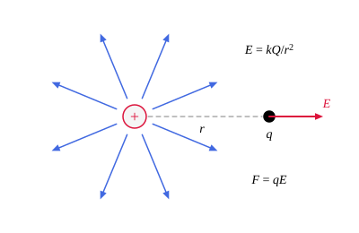

Как заряд «чувствует» другой заряд на расстоянии? Через электрическое поле. Эта тема даёт язык для всей электростатики и нужна в задачах 11, 14, 15 и 25.

Что вокруг заряда есть поле, говорят в 8 классе. Напряжённость, потенциал и напряжение — в 10. Пригодятся темы «Закон Кулона» и «Механическая энергия»: потенциал устроен так же, как потенциальная энергия в поле тяжести.

## Шаг 1. Электрическое поле (8 класс)

Наэлектризованная палочка притягивает бумажку, даже не касаясь её. Значит, между ними что-то есть. Каждый заряд создаёт вокруг себя **электрическое поле**. Другой заряд, попав в это поле, испытывает силу.

Поле сильнее вблизи заряда и слабеет с расстоянием. Оно существует и в вакууме — ему не нужен воздух.

## Шаг 2. Напряжённость (10 класс)

Чтобы описать поле числом, в него помещают маленький **пробный** заряд и смотрят на силу. **Напряжённость** $\vec E$ — сила, действующая на единичный положительный пробный заряд:

$$
\vec E = \frac{\vec F}{q}.
$$

Единица — Н/Кл, или, что то же, В/м. На положительный заряд сила действует по направлению $\vec E$, на отрицательный — против.

Напряжённость — свойство самого поля: она не зависит от того, какой пробный заряд мы взяли.

<pp-task id="ks-field-01"></pp-task>

## Шаг 3. Поле точечного заряда (10 класс)

Подставим в $E = F/q$ силу Кулона. Поле точечного заряда $Q$ на расстоянии $r$:

$$
E = k\,\frac{|Q|}{r^2}.
$$

Поле положительного заряда направлено от него, отрицательного — к нему.

<pp-task id="ks-field-02"></pp-task>

## Шаг 4. Суперпозиция и линии поля (10 класс)

**Принцип суперпозиции**: поле нескольких зарядов — векторная сумма их полей.

Поле рисуют линиями. Касательная к линии показывает направление $\vec E$, густота линий — модуль. Линии начинаются на положительных зарядах и заканчиваются на отрицательных.

**Однородное поле** — одинаковое во всех точках. Пример — поле между пластинами плоского конденсатора: линии параллельны и идут с одинаковой густотой.

<pp-task id="ks-field-03"></pp-task>

## Шаг 5. Работа поля и напряжение (10 класс)

Заряд, отпущенный в поле, разгоняется — поле совершает работу. Электростатическое поле, как и поле тяжести, **потенциально**: работа не зависит от формы пути, только от начальной и конечной точек.

**Потенциал** $\varphi$ — энергетическая характеристика поля: потенциальная энергия единичного положительного заряда в данной точке. Единица — вольт (В). Энергия заряда $q$ в точке с потенциалом $\varphi$: $W = q\varphi$.

**Напряжение** (разность потенциалов) между точками 1 и 2 и работа поля:

$$
U = \varphi_1 - \varphi_2,
\qquad
A_{12} = q\,(\varphi_1 - \varphi_2) = qU.
$$

<pp-task id="ks-field-04"></pp-task>

## Шаг 6. Однородное поле: $U = Ed$ (10 класс)

В однородном поле сила $qE$ постоянна, и работа при перемещении на $d$ вдоль линий поля равна $qEd$. Сравнивая с $A = qU$:

$$
U = E d.
$$

Здесь $d$ — расстояние **вдоль линий поля**. Если заряд движется перпендикулярно линиям поля, работа равна нулю. Такие поверхности называют **эквипотенциальными**.

<pp-task id="ks-field-05"></pp-task>

## Шаг 7. Потенциал точечного заряда (10 класс)

Потенциал поля точечного заряда $Q$ на расстоянии $r$:

$$
\varphi = k\,\frac{Q}{r}.
$$

Знак $Q$ учитывается: у отрицательного заряда потенциал отрицательный. Ноль — на бесконечности. Потенциалы нескольких зарядов складываются как **числа**, а не как векторы — это удобнее, чем с напряжённостью.

<pp-task id="ks-field-06"></pp-task>

## Шаг 8. Разгон заряда в поле (10 класс)

Заряд разгоняется разностью потенциалов $U$. Работа поля идёт на кинетическую энергию (тема «Механическая энергия»):

$$
\frac{m v_2^2}{2} - \frac{m v_1^2}{2} = q\,(\varphi_1 - \varphi_2).
$$

Положительный заряд сам движется к меньшему потенциалу, а **электрон — к большему**: у него $q < 0$, и работа поля положительна, когда $\varphi_2 > \varphi_1$.

Энергию частиц часто выражают в **электронвольтах**: $1\ \text{эВ} = 1{,}6 \cdot 10^{-19}\ \text{Дж}$ — энергия, которую получает электрон, пройдя разность потенциалов $1\ \text{В}$.

<pp-task id="ks-field-07"></pp-task>

## Частые ловушки

- **Путают знак силы для отрицательного заряда.** Электрон в поле движется против $\vec E$.
- **Складывают напряжённости как числа.** Это векторы.
- **В $U = Ed$ берут расстояние не вдоль линий поля.** Нужна проекция перемещения на направление поля.
- **Думают, что работа поля зависит от траектории.** В электростатике — нет.

## Как это выглядит на ЕГЭ

*Электрон, начальная скорость которого равна нулю, разгоняется электрическим полем, пройдя разность потенциалов $100\ \text{В}$. Какую кинетическую энергию он приобрёл?*

Работа поля равна изменению кинетической энергии:

$$
E_{\text{к}} = e U = 1{,}6 \cdot 10^{-19} \cdot 100 = 1{,}6 \cdot 10^{-17}\ \text{Дж}.
$$

В электронвольтах ответ ещё проще: $100\ \text{эВ}$.

## Коротко

- $\vec E = \vec F/q$; точечный заряд: $E = k|Q|/r^2$.
- Суперпозиция: поля складываются как векторы.
- $A_{12} = q(\varphi_1 - \varphi_2) = qU$; работа не зависит от пути.
- Однородное поле: $U = Ed$.
- Точечный заряд: $\varphi = kQ/r$; потенциалы складываются как числа.
- $1\ \text{эВ} = 1{,}6 \cdot 10^{-19}\ \text{Дж}$.
