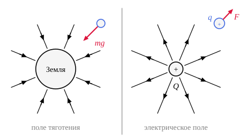

Наэлектризованная расчёска притягивает бумажки, не касаясь их (урок 1.1). Два заряда отталкиваются через воздух и даже через пустоту. Как же один заряд «узнаёт», что рядом есть другой? В механике был похожий вопрос: Земля притягивает яблоко, хотя между ними только воздух (урок 7.2 из механики). Ответ в обоих случаях один — поле.

## Поле — посредник

Каждый заряд создаёт вокруг себя **электрическое поле**. Это не вещество: его нельзя увидеть или потрогать. Но оно существует на самом деле, и у него есть главное свойство — оно действует на заряды. Другой заряд, попав в поле, испытывает силу.

Так что взаимодействие идёт в два шага: заряд $Q$ создаёт поле, а поле действует на заряд $q$. И наоборот: $q$ создаёт своё поле, которое действует на $Q$. Силы при этом равны и противоположны, как в уроке 1.4.

Сравни две половины рисунка. Земля создаёт поле тяготения, и оно тянет яблоко. Заряд $Q$ создаёт электрическое поле, и оно толкает заряд $q$. Линии на рисунке — условная картинка поля: они показывают, куда поле толкало бы. Подробно о таких линиях — в уроке 2.4.

Чем поле отличается от «просто расстояния»? Поле — физический объект. Оно есть и в вакууме: ему не нужен воздух, чтобы существовать. Если заряд резко сдвинуть, другой заряд почувствует это не сразу, а когда изменение поля до него долетит. Летит оно со скоростью света — это и есть радиоволны, о них в теме «Электромагнитные волны».

## Где поле сильнее

Поле сильнее вблизи заряда, создавшего его, и слабее вдали. Мы это уже знаем по закону Кулона (урок 1.5): чем дальше от заряда, тем меньше сила.

А ещё сила зависит от того, **какой** заряд мы поместили в поле. Возьмём одну и ту же точку поля. Поместим туда заряд — на него подействует какая-то сила. Поместим вдвое больший заряд — сила будет вдвое больше; втрое больший — втрое больше. Поле в точке одно и то же, а сила **пропорциональна** заряду, который в эту точку поместили. Это видно и из закона Кулона: заряд в нём стоит в первой степени.

Чтобы «прощупать» поле, в него вносят маленький **пробный** заряд — такой маленький, чтобы его собственное поле не сдвинуло заряды, которые создают изучаемое поле. Пробный заряд в поле — как термометр в воде: показывает, что там есть, не меняя этого.

<pp-task id="ks-field-08"></pp-task>

Проверь себя: в точке поля на пробный заряд действует сила. Заряд убрали. Осталось ли в этой точке поле?

Осталось. Поле создаёт другой заряд — источник, а пробный заряд лишь показывает, что поле есть. Убрали пробный заряд — исчезла сила, а поле осталось.

## Частые ловушки

- **«Без воздуха заряды не взаимодействуют».** Поле существует и в вакууме.
- **«Поле создаёт пробный заряд».** Поле создаёт заряд-источник; пробный заряд его только обнаруживает.
- **«В одной точке поля на любой заряд — одна и та же сила».** Сила пропорциональна заряду: в той же точке на вдвое больший заряд — вдвое большая сила.

## Коротко

- Заряд создаёт вокруг себя электрическое поле, и поле действует на другие заряды.
- Поле есть и в вакууме; вблизи заряда оно сильнее.
- В одной точке поля сила пропорциональна заряду, который туда поместили.

Дальше — урок 2.2: как описать поле в точке одним числом и направлением.
